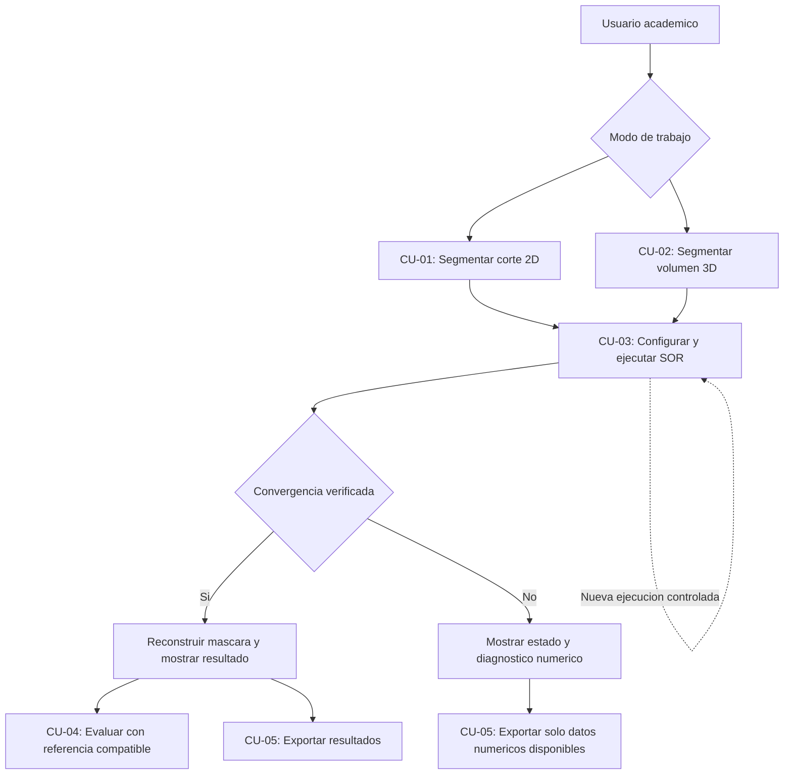

# NeuroVision — Especificación de casos de uso

**Versión:** 0.2 — línea base aprobada por el líder\
**Fecha:** 25 de noviembre de 2026\
**Base:** `01_Requisitos.md` (línea base aprobada por el líder) y decisiones D-01 a D-03 del registro de contexto v1.1.\
**Alcance:** segmentación asistida 2D y 3D mediante un único solucionador SOR propio.\
**Estado:** diseño funcional aprobado por el líder en conversación; no acredita implementación ni resultados de pruebas. Aprobación registrada como D-04 en el registro v1.2.

## 1. Propósito y actores

Los casos de uso describen qué hace el usuario y qué respuesta observable ofrece NeuroVision. Constituyen la base para los contratos, el diseño de la interfaz, la API y las pruebas de aceptación. No fijan aún rutas HTTP, estructuras de transporte, librerías nuevas ni algoritmos internos definitivos.

| Actor | Participación |
|---|---|
| Usuario académico | Actor principal de CU-01 a CU-05. Carga, selecciona, configura, ejecuta, consulta y exporta. |
| Equipo de desarrollo | Reproduce los flujos con datos de prueba y verifica sus criterios de aceptación. |
| Docente/evaluador | Revisa la demostración, resultados y evidencias. No requiere una cuenta ni permisos especiales en la aplicación. |

No se introduce autenticación, persistencia de pacientes ni diagnóstico automático.

## 2. Mapa de casos de uso

| ID | Caso de uso | Requisitos | Prioridad |
|---|---|---|---|
| CU-01 | Segmentar un corte 2D | RF-01, RF-03 a RF-08, RF-11 | Obligatoria |
| CU-02 | Segmentar una región 3D y visualizar su superficie | RF-02 a RF-07, RF-09 a RF-11 | Obligatoria |
| CU-03 | Configurar y analizar SOR | RF-07, RF-11, RF-12 | Configuración/resultado obligatorios; comparación alta |
| CU-04 | Evaluar una segmentación con referencia compatible | RF-13 | Alta, condicionada a referencia disponible |
| CU-05 | Exportar resultados | RF-14 | Exportación básica obligatoria |

El diagrama representa dependencias funcionales, no llamadas entre capas. CU-03 comparte la ejecución numérica de CU-01 y CU-02; no significa que deba existir una segunda ejecución automática. CU-04 es opcional en cada sesión; CU-05 se realiza a solicitud del usuario.

## 3. Reglas comunes de interacción

- **RC-01.** Seleccionar datos de investigación autorizados o sintéticos. La aplicación se identifica como educativa, no clínica.
- **RC-02.** Trabajar en coordenadas de los datos originales; zoom, desplazamiento, cambio de corte y recorte no alteran la posición de las semillas. Los límites de ROI, ejes y convenciones se especificarán en los contratos.
- **RC-03.** Exigir ambas clases de semillas, posiciones válidas sin contradicciones y al menos una incógnita. El modelo aprobado deberá garantizar que cada componente de incógnitas alcance una semilla mediante conexiones válidas.
- **RC-04.** Validar parámetros de SOR, incluidos omega en el intervalo abierto (0,2), tolerancias y máximo de iteraciones. Los valores por defecto y límites concretos se definirán con experimentos.
- **RC-05.** Guardar en el contexto de la ejecución la selección, configuración y resultados que realmente le corresponden. Si cambian datos, ROI, semillas o parámetros, invalidar la asociación con la ejecución actual; no mostrar resultados antiguos como si fueran nuevos. No implica persistencia entre sesiones.
- **RC-06.** Mostrar el estado del procesamiento y controlar solicitudes inválidas, fallos y ejecuciones incompletas. No prometer actualizaciones en tiempo real, cancelación ni ejecución en segundo plano: el mecanismo se decidirá en Control.
- **RC-07.** Mostrar una máscara como válida solo si la ejecución cumple el criterio de convergencia y la reconstrucción es válida. No convergencia y fallo numérico son distintos de fallo de visualización o de exportación.
- **RC-08.** Diferenciar la región no evaluada fuera de la ROI del fondo segmentado. No extrapolar una máscara fuera de la región calculada. No inferir profundidad a partir de un corte aislado.
- **RC-09.** Una máscara de referencia se emplea exclusivamente para evaluación, con selección independiente de la segmentación que se evalúa. No usarla para crear automáticamente las semillas, ajustar la ROI del caso de evaluación ni sustituir la máscara calculada.
- **RC-10.** Asociar cada salida con su configuración y procedencia no sensible. Conservar los registros de fallos; no publicar datos médicos ni credenciales en el repositorio.

## 4. CU-01 — Segmentar un corte 2D

**Actor principal:** usuario académico.\
**Disparador:** selecciona el modo 2D y desea delimitar una región de interés en un corte.\
**Precondiciones:** aplicación disponible; archivo de imagen autorizado; formatos, tamaño y resolución dentro del conjunto admitido que se acordará (JPEG/PNG candidatos). No requiere referencia.\
**Entradas:** imagen, ROI 2D, semillas primer plano/fondo, configuración SOR.

### Flujo principal

| Paso | Usuario | Sistema |
|---:|---|---|
| 1 | Selecciona modo 2D y carga la imagen. | Valida el archivo, decodifica y presenta el corte con dimensiones correctas. |
| 2 | Ajusta zoom/desplazamiento si lo necesita. | Mantiene la correspondencia entre pantalla y datos. |
| 3 | Delimita una ROI que contiene la región deseada y fondo circundante. | Registra sus límites y origen; valida que no esté vacía ni fuera de la imagen. |
| 4 | Marca semillas de primer plano y fondo. | Muestra las semillas y valida sus coordenadas y clases. |
| 5 | Configura SOR y solicita segmentar. | Valida configuración y selección, prepara el sistema disperso Ax=b y ejecuta SOR según CU-03. |
| 6 | Consulta el estado. | Informa el resultado numérico y, si converge, reconstruye probabilidades, máscara y contorno en la ROI. Conserva las semillas. |
| 7 | Inspecciona la región segmentada. | Permite comparar original y procesado mediante superposición/visualización equivalente y muestra la gráfica y métricas numéricas de CU-03. |
| 8 | Opcionalmente repite, evalúa o exporta. | Asocia cada resultado con su ejecución. CU-04 y CU-05 quedan disponibles cuando corresponda. |

### Flujos alternativos y excepciones

| ID | Condición | Respuesta esperada |
|---|---|---|
| CU-01.A1 | Archivo corrupto, formato no admitido o tamaño excesivo. | Rechaza con mensaje comprensible; no inicia cálculos ni usa datos de una ejecución anterior como nuevos. |
| CU-01.A2 | ROI vacía, fuera de límites o superior al límite admitido. | Solicita corregirla; no construye el sistema. |
| CU-01.A3 | Falta una clase de semilla, hay conflicto, semilla fuera de ROI o no quedan incógnitas. | Identifica el problema; solicita corregir y conserva la selección válida cuando sea posible. |
| CU-01.A4 | Configuración, sistema o ejecución numérica inválidos. | Aplica los flujos de error de CU-03. No genera una segmentación válida. |
| CU-01.A5 | Falla la reconstrucción o presentación tras convergencia. | Distingue el éxito numérico del fallo de resultado visual; conserva los datos numéricos disponibles. |
| CU-01.A6 | El usuario cambia la ROI, las semillas o parámetros. | Registra una nueva selección/configuración y solicita una nueva ejecución antes de asociar una máscara a ese estado. |

**Postcondición de éxito:** máscara y contorno correspondientes a la ejecución convergente, con coordenadas correctas, selección preservada y resultados numéricos consultables.\
**Garantía mínima ante fallo:** mensaje explícito, ausencia de una máscara falsa presentada como válida y disponibilidad de diagnóstico numérico cuando se haya producido.\
**Aceptación:** imagen sintética con geometría conocida; caso de investigación autorizado si está disponible; pruebas de ROI, semillas y coordenadas bajo zoom; verificar RF-01, RF-03 a RF-08 y RF-11.

## 5. CU-02 — Segmentar una región volumétrica y visualizarla

**Actor principal:** usuario académico.\
**Disparador:** selecciona el modo 3D y desea segmentar una región en un volumen de resonancia.\
**Precondiciones:** aplicación disponible; volumen autorizado, espacialmente coherente, de una secuencia admitida; geometría válida. NIfTI es el formato candidato, pendiente de inspección. No requiere referencia.\
**Entradas:** volumen, ROI 3D, semillas con posición volumétrica, configuración SOR y geometría espacial.

### Flujo principal

| Paso | Usuario | Sistema |
|---:|---|---|
| 1 | Selecciona modo 3D y carga el volumen. | Valida formato, dimensiones, número de secuencias admitidas, tamaño y geometría; prepara cortes navegables. |
| 2 | Recorre los cortes axiales. | Muestra el corte seleccionado y su posición; preserva el sistema de coordenadas del volumen. |
| 3 | Delimita los límites en el plano y el intervalo de cortes de la ROI. | Registra una región volumétrica rectangular/cuboidal como propuesta inicial de interacción y valida sus límites. |
| 4 | Marca semillas de primer plano y fondo en uno o varios cortes. | Registra cada semilla con su coordenada volumétrica; al navegar conserva las marcas y distingue a qué corte pertenecen. |
| 5 | Configura SOR y solicita segmentar. | Valida selección y configuración, construye un único sistema volumétrico disperso y ejecuta el mismo SOR de CU-01, según CU-03. |
| 6 | Consulta el estado. | Si converge y la reconstrucción es válida, obtiene el mapa de probabilidades y máscara 3D; conserva geometría, origen del recorte y semillas. |
| 7 | Recorre los cortes procesados. | Muestra máscara superpuesta en el corte correspondiente, permite comparar original/procesado y muestra el diagnóstico de SOR. |
| 8 | Solicita/consulta la superficie tridimensional. | Genera una malla a partir de la máscara obtenida, conservando escala, orientación y posición espacial. Informa límites o truncamiento cuando proceda. |
| 9 | Rota y amplía la superficie. | Presenta la malla interactiva sin alterar la máscara ni los datos espaciales de la ejecución. |
| 10 | Opcionalmente evalúa o exporta. | Habilita CU-04 con referencia compatible y CU-05 para las salidas disponibles. |

### Flujos alternativos y excepciones

| ID | Condición | Respuesta esperada |
|---|---|---|
| CU-02.A1 | JPG aislado, archivo corrupto, volumen no admitido, dimensión extra no seleccionada o geometría inválida. | Rechaza la carga 3D con explicación; un corte aislado podrá tratarse en 2D si su formato es válido, no como reconstrucción anatómica real. |
| CU-02.A2 | ROI fuera de límites, sin extensión válida en profundidad o demasiado grande. | Solicita corregir/reducir región; no construye el sistema excediendo límites aprobados. |
| CU-02.A3 | Semillas inválidas, contradictorias, insuficientes o fuera de la ROI. | Informa el error y permite corregir la selección sin perder las marcas válidas cuando sea posible. |
| CU-02.A4 | Sistema inválido o SOR no convergente. | Aplica CU-03; no presenta una máscara ni una malla como segmentación válida. |
| CU-02.A5 | Máscara válida pero vacía, degenerada o sin superficie representable. | Informa que no hay malla utilizable; no inventa una geometría. |
| CU-02.A6 | Región segmentada toca el borde de la ROI. | Advierte posible truncamiento; el tratamiento exacto de frontera se definirá en el modelo y los contratos. No presenta la superficie como un tumor completo si no se ha calculado fuera de la ROI. |
| CU-02.A7 | Falla la generación o el renderizado de la malla tras una segmentación válida. | Conserva la máscara y los resultados numéricos; informa que la visualización 3D no está disponible. No declara completo el flujo 3D. |
| CU-02.A8 | Se modifica selección, volumen o configuración. | Exige nueva ejecución para producir una máscara/malla correspondiente; distingue los resultados previos. |

**Postcondición de éxito:** máscara volumétrica válida, cortes procesados y malla interactiva derivada de esa máscara, con geometría preservada y resultados numéricos consultables.\
**Garantía mínima ante fallo:** error identificable y ausencia de una reconstrucción ficticia; conservar las salidas válidas independientes del fallo.\
**Aceptación:** volumen sintético de geometría conocida y ROI pequeña; comprobar origen, orientación y escala con un recorte desplazado; demostrar malla derivada de SOR y navegación por cortes; caso de investigación autorizado si está disponible. Verificar RF-02 a RF-07 y RF-09 a RF-11.

## 6. CU-03 — Configurar y analizar SOR

**Actor principal:** usuario académico.\
**Disparador:** configura o ejecuta SOR desde CU-01/CU-02; posteriormente puede repetir una ejecución para investigar omega y tamaño.\
**Precondiciones:** datos y selección válidos para ejecutar; sistema construible y conforme al modelo matemático que se apruebe.\
**Entradas:** sistema Ax=b preparado por Traducción, configuración, estado de selección asociado. La interfaz no envía ni construye A o b.

### Flujo principal

1. El usuario consulta los parámetros disponibles y selecciona omega, tolerancias y límite de iteraciones. La aplicación valida los valores y comunica sus unidades o significado.
2. Control coordina la construcción y validación del sistema disperso a través de Traducción. Métodos Numéricos recibe exclusivamente el sistema y la configuración numérica mediante contratos.
3. Métodos Numéricos ejecuta la única implementación propia de SOR, con la aproximación inicial y el criterio de parada que se acuerden. Registra el historial de residuo, iteraciones/barridos y tiempo del solver.
4. La aplicación comunica el estado final, configuración, residuo inicial/final, historial, iteraciones, barridos, tiempo y gráfica de convergencia. El tiempo del solver se distingue del tiempo de carga, construcción de sistema y reconstrucción.
5. Si la solución converge, se devuelve el resultado a CU-01 o CU-02 para reconstrucción. La convergencia numérica no implica por sí sola exactitud clínica ni solapamiento satisfactorio.
6. Para comparar omega, el usuario repite con el mismo caso, ROI, semillas, modelo, A, b, aproximación inicial, tolerancias, límite de iteraciones y condiciones de medición. Se registra el parámetro variado y también los intentos fallidos. Para estudiar tamaño, se documentan las diferencias de ROI/sistema y se controlan las demás condiciones en lo posible. La comparación puede realizarse con registros/exportaciones reproducibles, sin exigir un comparador visual avanzado.

### Flujos alternativos y excepciones

| ID | Condición | Respuesta esperada |
|---|---|---|
| CU-03.A1 | Omega fuera de (0,2), tolerancia o límite inválido. | Error de configuración antes de ejecutar. |
| CU-03.A2 | Sistema inconsistente, datos no finitos, diagonal inválida o componente sin conexión a semillas. | Error de entrada/construcción matemática; no se ejecuta como sistema válido. |
| CU-03.A3 | Se alcanza el límite de iteraciones sin satisfacer el criterio. | Estado explícito de no convergencia, residuos, tiempo y demás datos disponibles; no máscara válida. |
| CU-03.A4 | Se produce fallo numérico. | Estado distinto de no convergencia; diagnóstico disponible sin presentar solución inválida como resultado correcto. |
| CU-03.A5 | Se cambian varios parámetros al comparar. | Se identifican las condiciones distintas; no se presenta como comparación controlada exclusivamente de omega. |
| CU-03.A6 | No se puede completar la ejecución dentro de límites de recursos. | Error controlado y recomendación de reducir ROI o revisar configuración; mecanismo y límites aún por definir. |

**Postcondición de éxito numérico:** estado convergente y solución que satisface el criterio acordado, con registro suficiente para reconstrucción y repetición.\
**Garantía mínima ante fallo:** estado y evidencia disponible sin falsificar convergencia, métricas ni historia.\
**Aceptación:** sistema conocido A=[[2,-1],[-1,2]], b=[0,1], solución [1/3,2/3]; comprobar residuo independiente; casos inválidos y no convergencia; confirmar que CU-01 y CU-02 invocan la misma implementación. Comparar al menos dos omega bajo condiciones controladas (RF-12). Los solucionadores de referencia se permiten únicamente para verificación.

## 7. CU-04 — Evaluar con una referencia compatible

**Actor principal:** usuario académico.\
**Disparador:** solicita evaluar una máscara calculada y dispone de anotación de referencia.\
**Precondiciones:** segmentación válida y referencia autorizada, perteneciente al mismo caso y región objetivo; geometría, orientación, coordenadas y semántica de etiquetas compatibles. El formato de suministro de la referencia se decidirá en los contratos.\
**Entradas:** máscara calculada, referencia y definición de dominio de evaluación (por defecto propuesto: ROI procesada, expresamente identificada).

### Flujo principal

1. El usuario proporciona o selecciona una referencia de investigación para la ejecución ya realizada.
2. El sistema valida pertenencia al caso y correspondencia de dimensiones, geometría, transformación y etiquetas mediante la información disponible. No basta con que coincidan los tamaños.
3. Determina y comunica el dominio evaluado; alinea la referencia con las coordenadas de la máscara sin cambiar la segmentación calculada. La estrategia de transformación se definirá en los contratos; si no se puede asegurar correspondencia, rechaza la comparación.
4. Servicios calcula Dice e IoU con la región binaria de referencia que se haya definido. Se muestra el resultado junto con la ejecución, alcance y referencia no sensible.
5. El usuario puede consultar o exportar las métricas disponibles.

### Flujos alternativos y excepciones

| ID | Condición | Respuesta esperada |
|---|---|---|
| CU-04.A1 | No hay referencia. | Dice e IoU se muestran como no disponibles. CU-01/CU-02 pueden finalizar sin evaluación. |
| CU-04.A2 | Referencia de otro caso, diferente semántica o geometría incompatible/no verificable. | Rechaza las métricas; no modifica la máscara ni compara arrays solo por su tamaño. |
| CU-04.A3 | Máscara calculada inválida o ejecución no convergente. | No calcula métricas de una segmentación válida. |
| CU-04.A4 | Denominador nulo en una métrica. | Aplica la convención que se acuerde y la documenta; provisionalmente informa no definida si ambas máscaras están vacías. |

**Postcondición:** métricas trazables a máscara, referencia y dominio; no se presentan como validación diagnóstica.\
**Aceptación:** solapamiento perfecto, parcial, disjunto y caso vacío; referencia incompatible rechazada; ejecución sin referencia sigue siendo usable; comprobar que cambiar la referencia no cambia la máscara evaluada (RF-13).

## 8. CU-05 — Exportar resultados de una ejecución

**Actor principal:** usuario académico.\
**Disparador:** solicita descargar las salidas de una ejecución.\
**Precondiciones:** ejecución identificable con resultados numéricos disponibles; para exportar imagen segmentada, máscara válida.\
**Entradas:** resultado seleccionado y tipo de exportación admitido.

### Flujo principal

1. El usuario consulta las salidas disponibles para la ejecución seleccionada.
2. El sistema prepara una exportación numérica básica en CSV o TXT, con parámetros, estado, iteraciones/barridos, tiempo, residuos e historial; incorpora métricas de evaluación si existen y están correctamente identificadas.
3. Si existe una segmentación válida, prepara una imagen procesada 2D o al menos un corte 3D procesado, identificado con su índice/posición y ROI. El formato concreto de imagen se fijará en los contratos. No se denomina volumen a una exportación de un único corte.
4. El usuario descarga los archivos. El sistema conserva la asociación con la ejecución y evita incluir información personal innecesaria.

### Flujos alternativos y excepciones

| ID | Condición | Respuesta esperada |
|---|---|---|
| CU-05.A1 | No convergencia/fallo con diagnóstico disponible. | Permite exportar el diagnóstico numérico disponible con su estado, pero no una imagen segmentada presentada como válida. |
| CU-05.A2 | No existe un resultado para el tipo solicitado. | Informa indisponibilidad; no crea un archivo vacío presentado como resultado completo. |
| CU-05.A3 | Error al generar o transferir el archivo. | Informa el fallo; permite reintentar la exportación sin repetir la segmentación si los resultados siguen disponibles. |
| CU-05.A4 | Solicita exportación volumétrica, malla, gráficas descargables u otro formato no aprobado. | Solo se ofrece si se ha acordado e implementado; no constituye parte de la exportación mínima de esta versión. |

**Postcondición:** archivos recuperables y coherentes con una ejecución concreta; datos de fallo distinguidos de resultados válidos.\
**Aceptación:** abrir exportación numérica y contrastar datos con ejecución; abrir imagen y comprobar correspondencia con máscara/corte; comprobar exportación de diagnóstico sin imagen válida ante no convergencia (RF-14).

## 9. Participación de las cinco capas

| Capa | Responsable | Participación funcional |
|---|---|---|
| Interfaz | Johan | Todos los casos: selección, visualización, configuración, mensajes de estado, presentación y descargas. |
| Control | Jherson | Todos los casos: validación de solicitudes, coordinación por APIs públicas, gestión de ejecución y traducción de errores hacia la interfaz. |
| Traducción de Datos | Yenderson | CU-01/02/03: decodificación, normalización, geometría, construcción del sistema, reconstrucción; apoyo a la validación geométrica de referencias de CU-04. |
| Métodos Numéricos | Jennifer | CU-03: solver SOR propio, resultado numérico, convergencia y diagnóstico. Se reutiliza en ambos modos. |
| Servicios | Yenderson | CU-01/02/03/04/05: mallas, métricas, gráficas y preparación de exportaciones. No resuelve Ax=b. |

Control coordina las tres capas especializadas; no se comunican directamente entre sí. Interfaz solo se comunica con Control. Los contratos compartidos no forman una sexta capa. Los formatos y firmas concretos pertenecen al documento de contratos.

## 10. Trazabilidad de requisitos no funcionales

| Requisito | Casos asociados | Verificación propuesta |
|---|---|---|
| RNF-01 Modularidad | Todos | Import Linter y revisión de límites públicos. |
| RNF-02 Corrección numérica | CU-01, CU-02, CU-03 | Solver único, residuo independiente, caso conocido. |
| RNF-03 Rendimiento | CU-01, CU-02, CU-03 | CSR, límites experimentales, medición de recursos. |
| RNF-04 Robustez | Todos | Flujos alternativos y validación de entradas. |
| RNF-05 Integridad geométrica | CU-01, CU-02, CU-04, CU-05 | Coordenadas, recorte, orientación y referencia compatibles. |
| RNF-06 Privacidad | Todos | Procedencia autorizada y revisión de archivos/versionado. |
| RNF-07 Reproducibilidad | Todos, especialmente CU-03/04/05 | Registro de configuración y condiciones, versiones y dependencias. |
| RNF-08 Calidad | Todos | Pruebas y CI manual completo del candidato según política vigente. |
| RNF-09 Usabilidad | Todos | Demostración de flujos principales y errores comprensibles. |
| RNF-10 Trazabilidad académica | Transversal | Historial de contribuciones, revisiones, documentación y manual de usuario. |

Los IDs de alternativas son referencias para diseñar pruebas; no son códigos HTTP definitivos. No se considera ejecutada ninguna prueba por estar descrita aquí.

## 11. Decisiones de diseño pendientes

| Tema | Cierre requerido antes de implementar |
|---|---|
| Datos | Formatos 2D/3D, secuencia, licencias y etiquetas, inspección de casos reales autorizados. |
| Modelo | Random Walker binario como candidato; validar en 2D/3D, pesos, condiciones SPD, conectividad, frontera, anisotropía y umbral. |
| SOR | Criterio de residuo, valores por defecto, límites, orden de incógnitas, exactitud y rendimiento. |
| Interacción/contratos | Límites cuboidales propuestos, ejes, coordenadas, transporte, vida de la selección y resultados durante la sesión; estrategia de error y ejecución. |
| Evaluación | Etiquetas de región objetivo, dominio (ROI o volumen completo evaluable), compatibilidad y convenciones de métricas. |
| Exportación | Elegir CSV o TXT, formato de imagen, esquema de metadatos; reconciliar cualquier exigencia restante de la rúbrica. |
| Tecnología | Compatibilidad, licencia, tipado y pruebas para NiBabel, scikit-image y Three.js. No incorporar dependencias antes de aprobarlas. |
| Gestión | Tiempo restante y responsabilidades compartidas, sin redistribuir roles sin acuerdo. |

## 12. Cierre de esta etapa

Los cinco flujos y sus alternativas quedan aprobados por el líder como línea base funcional. Compartir con el equipo y registrar cualquier cambio antes de alterar la línea base de requisitos. Continuar con `modelo_matematico.md` y la inspección de los datos. Las decisiones de arquitectura, contratos y límites operativos se concretarán a partir de esa validación. No se modifica el repositorio ni se crean tareas en Jira mediante este documento.
