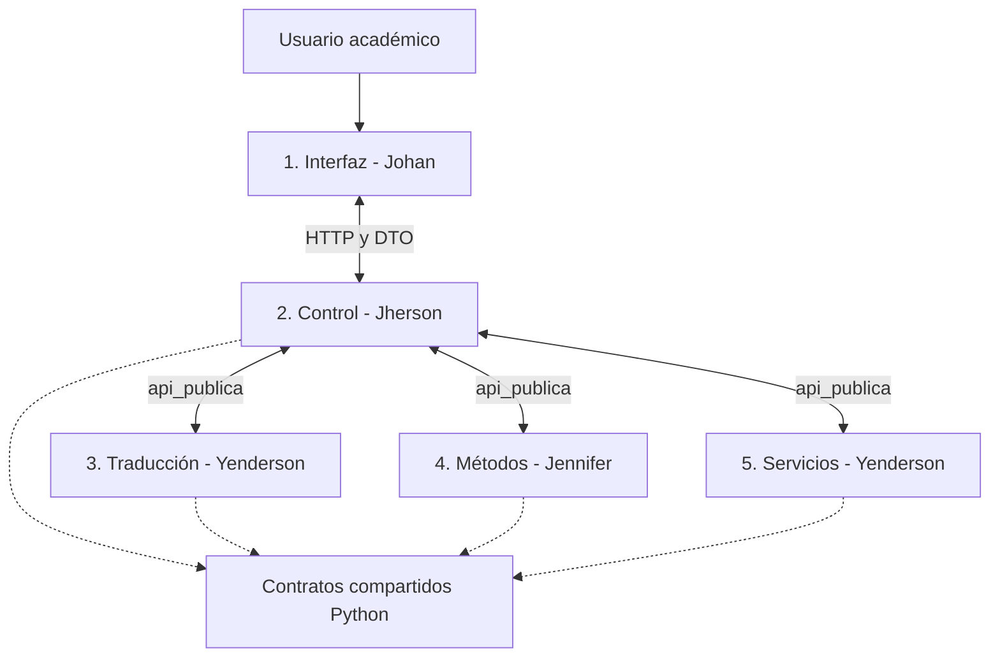
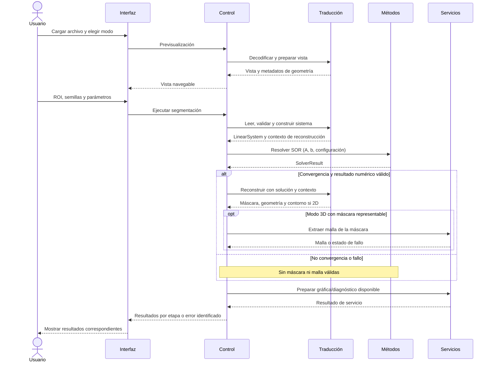

# NeuroVision — Arquitectura de software

**Versión:** 0.2 — enfoque arquitectónico aprobado por el líder; detalles de contratos y validación pendientes\
**Fecha:** 25 de noviembre de 2026\
**Alcance vigente:** segmentación asistida 2D y 3D, escala de grises, SOR propio como único solucionador\
**Repositorio:** https://github.com/NeuroVisionOrg/NeuroVision\
**Base remota consultada:** `develop`, commit `3f9d65c34d868721876e4a8308dd2e55153dc632`, protegida. Se verificaron el árbol y los contratos/código base relevantes; no se realizó un cambio remoto ni se ejecutó CI.

## 1. Propósito, autoridad y estado

**Control de aprobación (25 de noviembre de 2026).** El líder expresa conformidad con la arquitectura A-01 a A-07. Se adopta como línea base de diseño; las comprobaciones de viabilidad, dependencias, límites y geometría siguen pendientes. Su observación sobre memoria se interpreta como que no es una restricción prioritaria, no como medición de RAM disponible ni autorización para cargas ilimitadas. El diseño original se conserva; `contratos.md` concreta propuestas para las interfaces, aún por revisar.

Este documento define los límites de responsabilidad, los componentes y el flujo de datos del prototipo. Es la cuarta pieza de los siete documentos acordados y antecede a `contratos.md`, donde se formalizarán firmas, tipos, campos, formatos HTTP y errores. No contiene implementación definitiva ni acredita funcionalidades terminadas.

| Fuente de diseño | Aplicación |
|---|---|
| `01_Requisitos.md` | RF-01 a RF-14 y RNF-01 a RNF-10; línea base aprobada por el líder. |
| `02_Casos_de_uso.md` | CU-01 a CU-05, RC-01 a RC-10 y flujos de excepción. |
| `modelo_matematico.md` | Random Walker binario 4/6 vecinos, SOR en CSR, condiciones de validez y propuestas matemáticas. |
| `Anexo_validacion_datos.md` | Inspección de BRISC y caso MHA; restricciones escalares y verificaciones pendientes. |
| `03_Registro_de_decisiones_v1.4.md` y actualización v1.5 | Decisiones vigentes, infraestructura y estado de partida. |
| `04_Roles_y_cronograma.md` | Responsabilidades, tres semanas y presupuesto inicial provisional. |

Según la nueva indicación docente comunicada por el líder, el único método numérico obligatorio es SOR. El equipo mantiene ambos modos. No se implementarán Jacobi, Gauss-Seidel ni SSOR como solvers independientes. La modificación no altera las fuentes originales del docente ni supone aprobación individual de los demás integrantes. Random Walker y las tres nuevas dependencias no son exigencias textuales del profesor; el primero es la línea base matemática aceptada, sujeta a validación, y las dependencias son candidatas.

## 2. Decisiones y restricciones arquitectónicas

- Monolito modular: un frontend web y un backend Python, sin microservicios ni base de datos persistente. Conservar la arquitectura de cinco capas y sus responsables.
- Una sola intensidad por píxel/vóxel y una sola modalidad por ejecución; no RGB real, fusión multimodal, clasificación o IA. Una imagen gris almacenada en RGB con canales idénticos puede reducirse a un canal sin pérdida. La visualización de marcas en color no altera las intensidades usadas por el modelo.
- Dos rutas de entrada y presentación, un núcleo matemático compartido. SOR trabaja con `LinearSystem` y `SolverConfig`, nunca con imágenes, semillas, HTTP o mallas. Random Walker construye el sistema; SOR lo resuelve; la reconstrucción recompone el dominio; Marching Cubes extrae la superficie. No intercambiar esas responsabilidades.
- Conservar datos originales, información de geometría, correspondencia índice-coordenada y configuración por ejecución. No interpretar el exterior de la ROI como fondo calculado, ni inferir volumen anatómico de una imagen aislada.
- Propuesta de despliegue inicial: aplicación local para demostración e investigación educativa, sin autenticación ni persistencia médica. No abrir el servidor a Internet ni tratar datos de pacientes sin autorización. No agregar DICOM, servicios de cola, streaming, procesamiento masivo ni otras tecnologías sin necesidad demostrada.
- Prioridad: realizar ambos modos de extremo a extremo, diagnóstico numérico y exportación básica; limitar recursos y recortar funciones avanzadas. Las evaluaciones de omega, Dice e IoU conservan prioridad alta, condicionadas a datos compatibles cuando corresponda. No prometer rendimiento ni precisión clínica.

## 3. Vista de componentes y dependencias



Las líneas entre Control y las capas especializadas representan llamadas y retornos en el mismo proceso; no son tres servicios HTTP. Las líneas hacia contratos representan dependencias de tipos. Interfaz solo conoce el protocolo público de Control; las estructuras TypeScript de transporte corresponden a las DTO de la API, no importan las clases Python. `contratos/` es soporte compartido, no una sexta capa.

| Origen / destino de importación o comunicación | Interfaz | Control | Traducción | Métodos | Servicios | Contratos Python |
|---|---|---|---|---|---|---|
| Interfaz | Interna | Solo HTTP | No | No | No | No (DTO TS propias) |
| Control | No | Interna | API pública | API pública | API pública | Sí |
| Traducción | No | No | Interna | No | No | Sí |
| Métodos | No | No | No | Interna | No | Sí |
| Servicios | No | No | No | No | Interna | Sí |
| Contratos | No | No | No | No | No | Interna |

Importaciones a las capas hermanas, dependencias inversas y accesos a módulos privados están prohibidos. La composición de la aplicación pertenece a Control y su punto de entrada existente `main.py`. Conservar Import Linter y las pruebas AST; revisar que las futuras reglas impidan también dependencias numéricas hacia NiBabel, scikit-image y las librerías de presentación. No relajar controles. Tipos compartidos de datos/álgebra pueden emplear NumPy y CSR; no contienen llamadas de aplicación, HTTP ni lógica de procesamiento específica.

## 4. Responsabilidades y componentes por capa

### 4.1 Capa 1 — Interfaz (Johan)

Ruta existente: `capa_1_interfaz/`. HTML/CSS, TypeScript vanilla, Konva, Vite, Node 22 y npm. Three.js es candidata para representar mallas.

| Componente lógico | Responsabilidad | Entrada / salida |
|---|---|---|
| Carga y selección de modo | Seleccionar archivo, conservar el original durante la sesión, solicitar previsualización y presentar errores. | Archivo local → metadatos y vista preparados por Control. |
| Visor 2D y de cortes | Renderizar datos grises, zoom, desplazamiento, navegación axial inicial. | Previsualización y geometría de pantalla → coordenadas del dominio de trabajo. |
| ROI y semillas | Selección rectangular/cuboidal, límites de profundidad, marcas FG/BG y edición por corte. | Coordenadas de datos; ambas clases, sin modificar intensidades. |
| Ejecución | Parámetros de SOR y del modelo permitidos, solicitud, estado ocupado, protección contra respuestas obsoletas. | Selección + configuración → solicitud y respuesta identificadas. |
| Resultados y comparación | Original/procesado, máscara/contorno, historial, parámetros, estado y métricas; comparación simple de ejecuciones SOR. | Resultados con identidad de ejecución y ROI. |
| Visor 3D | Presentar vértices y caras, rotación/zoom, advertencias de superficie parcial o fallo. | Malla en espacio declarado, no segmenta. |
| Exportación | Solicitar y descargar archivos preparados por Servicios vía Control. | Resultado de la sesión, tipo de exportación y corte elegido. |

La Interfaz valida para mejorar la experiencia, pero Control revalida toda entrada. No decodifica el volumen para calcular pesos, no arma A,b, no ejecuta SOR, no umbraliza probabilidades para producir la máscara oficial, no genera mallas a partir de la máscara ni calcula Dice/IoU. La transformación pantalla-datos, la selección y el renderizado son responsabilidades de presentación. Puede conservar vistas de 8 bits únicamente para visualizar; nunca se envían como sustituto de la resonancia original en el cálculo. No necesita un framework web adicional.

### 4.2 Capa 2 — Control (Jherson)

Ruta existente: `capa_2_control/`. FastAPI, Pydantic, Uvicorn, python-multipart. Responsable del diseño de contratos y de la integración.

| Componente lógico | Responsabilidad |
|---|---|
| API HTTP | Recepción de archivos y DTO, versionado, límites, validación de estructura, respuesta y traducción de errores. Conservar `/api/v1/health` según la implementación existente. |
| Validaciones de composición | Comprobar modo, dimensiones, límites de ROI, clases de semillas, coordenadas, parámetros, identidad de entrada y coherencia de resultados. |
| Caso de uso de previsualización | Invocar Traducción y devolver vista/metadatos sin calcular segmentación. |
| Caso de uso de segmentación | Coordinar decodificación, preparación, construcción, SOR, reconstrucción y presentación de resultados comunes. |
| Casos de uso de evaluación y exportación | Validar contexto de resultado, solicitar verificación de referencia y delegar cálculos/archivos a Servicios. No repetir SOR para descargar un resultado. |
| Gestión de ejecución | Estado por etapa, trazabilidad, límites de recursos, limpieza, tratamiento de errores y resultados parciales. |

Control recibe y dirige: nunca calcula pesos, resuelve matrices, construye contornos ni genera la malla o gráficas específicas. Delega validaciones especializadas (formato, afinidad geométrica, conectividad, valores efectivos del sistema, integridad numérica) y convierte sus fallos en respuestas comprensibles. No importa módulos internos de las capas especializadas; usa `api_publica.py` de cada una. Las DTO HTTP y su adaptación hacia contratos internos son responsabilidad de Control, no de `contratos/`.

### 4.3 Capa 3 — Traducción de Datos (Yenderson)

Ruta existente: `capa_3_traduccion/`. Pillow, NumPy, SciPy CSR; NiBabel candidata para NIfTI.

| Componente lógico | Responsabilidad |
|---|---|
| Lectores 2D/3D | Decodificar JPEG/PNG gris o RGB acromático y volumen escalar aprobado; comprobar formas, valores finitos, tipo y geometría. |
| Geometría y preparación | Conservar orientación, transformación del volumen de trabajo al original, afín, unidades y origen de ROI; preparar vista y recorte; normalizar de forma reproducible. |
| Constructor Random Walker | Grafo escalar 4/6 vecinos, pesos positivos simétricos, conectividad de incógnitas a semillas, ensamblaje disperso de A,b. |
| Correspondencia de incógnitas | Mapa biyectivo entre posición local de ROI y fila de A; orden fijo y reproducible. |
| Reconstrucción | Restituir semillas, colocar probabilidades, validar rango, aplicar umbral y producir máscara, contorno 2D y contexto espacial. |
| Referencias | Decodificar máscaras de referencia, verificar geometría/semántica y preparar comparación en dominio común; sin usar referencia para producir la máscara. |

Propuesta: mantener una rutina común de construcción/reconstrucción parametrizada por dimensión y vecindad, con adaptadores para lectura y coordenadas 2D/3D. Evitar dos algoritmos Random Walker copiados. Construir A en CSR sin Laplaciano denso ni matrices completas innecesarias. Traducción garantiza las precondiciones matemáticas del Laplaciano reducido, no delega un solver externo. Su API pública entrega el sistema y un contexto de reconstrucción separado. El contexto nunca se pasa a Métodos si contiene información de imagen. No importa Métodos ni Servicios.

Los datos de vista no deben confundirse con datos numéricos. La normalización de cálculo se aplicará coherentemente en la ROI según el modelo matemático aprobado en detalle (min–max es candidato, incluida la intensidad constante). `ImageData` existente exige valores normalizados; el diseño de contratos debe distinguir los datos decodificados de los preparados para el grafo, sin normalizar cada corte 3D independientemente ni perder precisión mediante cuantización a 8 bits antes del cálculo.

### 4.4 Capa 4 — Métodos Numéricos (Jennifer)

Ruta existente: `capa_4_metodos/`. Python, NumPy, SciPy CSR. Una única operación de resolución SOR, independiente de si n proviene de un dominio 2D o 3D.

| Componente lógico | Responsabilidad |
|---|---|
| Validación numérica | Consistencia de A,b,x0, diagonal, valores finitos, omega y criterio de parada efectivo. |
| Núcleo SOR | Recorrer filas CSR en orden acordado; actualizar incógnitas en sitio, sin modificar A ni b, mediante fórmula SOR propia. |
| Criterio de parada | Residuo del sistema original, tolerancias, máximo de barridos, comprobación inicial y estados de ejecución. |
| Diagnóstico | Solución cuando proceda, historial, iteraciones/barridos, estado, tiempo de solver y parámetros. Ante fallo, preservar evidencia finita disponible. |
| Verificación y experimentación | Casos de solución conocida, referencia externa solo en pruebas, variaciones de omega y tamaños. |

La capa no recibe `ImageData`, `VolumeData`, ROI, semillas, máscaras, geometría, archivos o DTO HTTP. No depende de las otras capas. No recorta los iterados a [0,1]; la reconstrucción valida el rango posterior. El criterio de parada candidato es ||b−Ax||₂ ≤ max(atol, rtol||b||₂), con omega en (0,2). El resultado debe distinguir `CONVERGED`, `MAX_ITERATIONS` y `NUMERICAL_FAILURE`; códigos y campos se concretarán en contratos. Si la solución no es válida, no se construye máscara presentada como correcta.

### 4.5 Capa 5 — Servicios (Yenderson)

Ruta existente: `capa_5_servicios/`. NumPy y Matplotlib; scikit-image candidata para Marching Cubes.

| Componente lógico | Responsabilidad |
|---|---|
| Mallas | Extraer superficie triangular de una máscara 3D válida y aplicar transformación física declarada. Validar vértices/caras, degeneración y frontera. |
| Métricas | Contar primer plano y calcular Dice/IoU con referencia compatible y dominio explícito. Si no hay referencia, no inventar métricas. |
| Gráficas | Preparar gráfica de convergencia e información comparativa de SOR a partir de los resultados, sin ejecutar el solver. |
| Exportaciones | Preparar CSV o TXT con configuración/diagnóstico e imagen procesada (2D o corte 3D identificado), incluida la distinción fuera de ROI. |
| Evidencia | Preparar registros de resultados y condiciones experimentales sin datos personales ni persistencia obligatoria. |

Servicios recibe entradas ya preparadas por Control a partir de los contratos compartidos. No lee directamente el archivo médico para construir A,b, no umbraliza una solución como sustituto de Traducción y no vuelve a llamar al solver. Marching Cubes se aplica a la máscara producida a partir de SOR; no es un método de resolución de sistemas. Si la malla falla tras una reconstrucción válida, conservar diagnóstico y máscara, pero informar que la visualización 3D no se completó. Una máscara de prueba sintética utilizada para verificar aisladamente mallas se distingue del resultado integral.

## 5. Flujo compartido de segmentación



| Paso | Particularidad 2D | Particularidad 3D | Elemento común |
|---|---|---|---|
| Carga | JPEG/PNG gris | NIfTI escalar candidato | Validación, preparación de vista |
| Selección | Rectángulo x,y | Cuboide e intervalo de cortes, semillas 3D | ROI no vacía, ambas clases, coordenadas de datos |
| Grafo | 4 vecinos | 6 vecinos | L_UU, −L_UM p_M, CSR |
| Resolución | n incógnitas | n incógnitas | Misma operación SOR y criterio de parada |
| Reconstrucción | Máscara y contorno 2D | Máscara volumétrica y cortes | Contexto y semillas exactas; umbral candidato |
| Servicios | Imagen procesada | Malla 3D y corte procesado | Diagnóstico, gráfica, evaluación y exportación básica |

En un barrido de omega, congelar A,b, x0, orden y tolerancias. Puede repetirse la solicitud completa de forma determinista en el MVP; para mediciones estrictamente comparables, preparar una vez el sistema en una prueba/experimento controlado y verificar identidad de sus datos. No medir el tiempo de red, decodificación, construcción y malla como si fuera tiempo de SOR. No es necesario un comparador web avanzado para satisfacer RF-12.

## 6. Vista de datos y contratos previstos

| Contrato lógico | Uso | Estado |
|---|---|---|
| `ImageData`, `ROISelection`, `Seed`, `SeedSelection`, `SeedLabel` | Entrada normalizada 2D, coordenadas y selección | Existen; conservar semántica útil y revisar preparación. |
| `VolumeData`, `ROI3DSelection`, `Seed3D`, `Seed3DSelection` | Entrada escalar 3D y selección | Diseñar. Compartir etiqueta binaria. |
| Contexto geométrico/preparación | Forma de trabajo, afín, transformación al original, origen ROI, normalización, orden de índices, correspondencia de incógnitas | Diseñar; pertenece a Traducción y contratos de datos. |
| `LinearSystem` | A CSR float64 canónica, b float64 | Existe; conservar y revisar validaciones estructurales. |
| `SolverConfig`, `SolverResult`, `SolverStatus` | Configuración y diagnóstico SOR | Existen; restringir al alcance SOR y retirar reglas SSOR; revisar consistencia/finitud y representación de fallos. |
| `SegmentationResult` | Probabilidades, máscara y contorno 2D | Existe; reforzar invariantes y asociación a ROI. |
| `VolumeSegmentationResult`, `MeshData` | Máscara 3D y geometría triangular | Diseñar. |
| `MetricsResult`, `ExportResult` | Métricas y archivos | Existen; generalizar conteos a píxeles/vóxeles y dominio de comparación, conservar semántica de archivo. |
| Contexto de ejecución y DTO HTTP | Identidad, estado por etapa, configuración efectiva, presentación y errores | Diseñar en Control y TypeScript. No serializar clases/CSR directamente. |

`LinearSystem` no demuestra SPD para cualquier matriz arbitraria. Traducción asegura las condiciones del modelo al construirlo; Métodos comprueba precondiciones numéricas y no afirma convergencia universal. Evitar comprobaciones densas de SPD en ejecución ordinaria; usar casos pequeños para verificación independiente. Revisar los contratos de salida actuales: un fallo que ocurra en medio de un barrido no debe obligar a fabricar residuos o soluciones; establecer semántica de barridos completos y diagnóstico disponible en el documento siguiente.

### 6.1 Geometría y coherencia espacial (propuesta)

- 2D: mantener arreglo `[y,x]`, coordenadas de usuario `(x,y)` con máximos exclusivos y origen arriba-izquierda. Decodificación, orientación EXIF y vista deben corresponder al mismo dominio. No asumir forma cuadrada.
- 3D: mantener índices `(i,j,k)` del volumen de trabajo y afín que los transforma al espacio físico; conservar mapeo a índices originales si se reorienta. Para el visor axial, evaluar reorientación por permutaciones/inversiones a RAS+ sin interpolación y limitar las geometrías soportadas. Si un plano no es axial, no etiquetarlo como tal. Rechazar geometrías fuera de política con explicación; anisotropía/oblicuidad/cizallamiento pendientes de verificación. No establecer convención final sin prueba con NIfTI.
- ROI: origen y máximos exclusivos, semillas en coordenadas de trabajo. Para una malla local, `world = H @ [v + origen_roi, 1]`, usando la afín del volumen de trabajo. No aplicar espaciado dos veces; compensar cualquier relleno y revisar orientación de caras. Un contacto con el borde implica posible truncamiento: advertir y representar superficie parcial o indicar indisponibilidad, sin completar artificialmente un tumor.
- Las máscaras se limitan al dominio calculado; no se presenta el exterior como fondo inferido. Las referencias se comparan solo cuando coinciden geometría y semántica, sobre el dominio declarado (ROI común propuesta). La referencia no aporta semillas ni se usa para construir el sistema.

## 7. Comunicación, ejecución y ciclo de vida

### 7.1 Estrategia propuesta para el MVP

Mantener el backend sin estado persistente entre solicitudes. La Interfaz conserva en memoria de la sesión el archivo original elegido, metadatos, selección y resultados actuales. Una previsualización solicita a Control una representación escalar compacta de solo visualización; el navegador puede navegar por los cortes preparados sin reenviar el volumen para cada cambio de corte. No se cuantifica el dato usado por SOR a partir de esa representación. En una solicitud de segmentación se vuelve a enviar el archivo original, junto con modo, identidad de entrada, selección y configuración. Control verifica que la nueva decodificación reproduce el dominio de trabajo y la geometría declarados; un identificador del contenido y versión de preparación permitirán comprobar correspondencia. No confiar en las dimensiones declaradas por el cliente.

La solución de no conservar el volumen en un almacén del servidor simplifica la limpieza, privacidad y despliegue y permite una primera integración. Tiene costes: la carga/decodificación se repite en cada nueva segmentación y una previsualización completa 3D consume memoria/red. Limitar el tamaño de volumen y de la respuesta; medir con el caso piloto de 6.082.560 vóxeles y con fixtures sintéticos. Preferir representación de vista uint8 compacta con metadatos de geometría, no listas JSON de millones de floats. El formato concreto de transporte, tamaño máximo y estrategia alternativa para previsualización si el límite no es viable se decidirán en `contratos.md` a partir de las pruebas. Si las mediciones requieren una caché temporal acotada, su duración, aislamiento y limpieza necesitarán una decisión adicional. No añadir persistencia, colas o servicios de caché en este borrador.

La solicitud de segmentación se resuelve de manera síncrona en términos de API (respuesta al terminar, sin prometer progreso en vivo, cancelación ni tareas en segundo plano). La operación CPU-bound no debe bloquear el event loop de FastAPI; ejecutar el caso de uso en un contexto síncrono/trabajador adecuado y acotar concurrencia y recursos. Deshabilitar ejecuciones duplicadas en la interfaz mientras procesa y verificar límites en el servidor; la interfaz no sustituye el control de concurrencia. Si el servidor rechaza por recursos ocupados, informar de forma controlada. Un timeout del cliente no implica cancelación del solver. Los detalles de ejecución, tiempos y límites deberán validarse antes del PR de integración.

### 7.2 Operaciones públicas HTTP lógicas (nombres provisionales)

| Operación candidata | Entrada de transporte | Salida | CU / RF |
|---|---|---|---|
| Salud (`/api/v1/health` existente) | Solicitud simple | Estado del servicio | Infraestructura |
| Previsualizar | Archivo original + modo | Metadatos, vista compacta, identidad de preparación | CU-01/02; RF-01–03 |
| Segmentar | Archivo original + ROI + semillas + configuración efectiva/identidad | Estado por etapa, diagnóstico, máscara en ROI y malla si 3D; resultados disponibles | CU-01/02/03; RF-04–12 |
| Evaluar | Resultado válido conservado por la sesión, contexto de geometría y referencia autorizada | Métricas y dominio de evaluación | CU-04; RF-13 |
| Exportar | Resultado/contexto de la sesión y tipo/corte, datos necesarios para generar la salida | Archivo básico recuperable | CU-05; RF-14 |

Los nombres/verbos de endpoints, payloads binarios y JSON, códigos HTTP, validaciones y límites se cerrarán en contratos; se conserva el prefijo versionado `/api/v1/` como propuesta. Solo las operaciones de carga/segmentación necesitan el archivo original para decodificar/calcular; si una exportación o evaluación requiere recuperar geometría/corte de origen, enviar explícitamente los datos necesarios sin invocar SOR de nuevo. Las operaciones de evaluación/exportación pueden funcionar sin almacenar resultados en el servidor si el cliente los reenvía de forma explícita. Control comprueba coherencia estructural, identidad de sesión y geometría; ello no certifica autenticidad de resultados manipulados por un cliente externo. El MVP es un prototipo local, no un registro de evidencia inmutable ni un servicio multiusuario clínico. Si se requiere certificación o autenticación, volver a analizar el alcance.

La comparación de ejecuciones conservará un resumen numérico e identificación por ejecución; se recomienda limitar las máscaras y mallas completas retenidas en memoria y liberar las reemplazadas. Cambios de archivo, modo, ROI, semillas, modelo o parámetros invalidan el resultado activo para esa selección; una vista o zoom no cambia la identidad numérica. Respuestas tardías deben descartarse o asociarse solo a su ejecución original. El estado de ejecución es distinto del de resultados o descargas. En exportaciones y registros no incluir nombre de paciente, ruta local absoluta, cabecera médica completa ni contenido de datos innecesario. No almacenar datos en `localStorage` por defecto; al cerrar la sesión se descartan archivos/vistas/resultados en memoria, salvo descargas explícitas. Control libera referencias y elimina archivos temporales al terminar o fallar; establecer limpieza de restos en caso de interrupción anormal. No afirmar borrado seguro físico ni ausencia de copias del navegador/sistema operativo.

### 7.3 Estados y fallos por etapa

| Etapa | Fallo representativo | Comportamiento |
|---|---|---|
| Admisión | Archivo ilegible, formato/color/modalidad/espacio no admitido, límites de tamaño | Rechazar y explicar; no iniciar SOR. |
| Selección/configuración | ROI inválida, semillas fuera, falta clase, omega no válido | Error de entrada; permitir corrección. |
| Construcción | Pesos inválidos, componente sin semilla, sistema inconsistente | Fallo de construcción; no llamar al solver. |
| SOR | Límite de iteraciones o error numérico | Conservar diagnóstico real; sin máscara ni malla válida. |
| Reconstrucción | Vector inconsistente, fuera de rango material, correspondencia rota | Mantener diagnóstico numérico; no máscara válida. |
| Malla/renderizado | Máscara truncada/degenerada, fallo de extracción o renderizado | Advertir o no ofrecer malla; conservar máscara válida; flujo 3D no completo si no se obtiene superficie requerida. |
| Evaluación | Referencia incompatible, ausente o semántica no admitida | Métricas no disponibles/invalidables; no afectar segmentación. |
| Exportación | Salida no disponible o transferencia fallida | Informar; reintentar sin recalcular SOR si resultado conservado. |

No usar una única bandera de éxito para todas las etapas. No devolver 200 con una máscara falsa ni ocultar fallo numérico. La representación de estados esperados de SOR y fallos de solicitud se acordará en la API de contratos; los estados numéricos no equivalen necesariamente a errores HTTP. Los registros técnicos conservarán código y fase del fallo, sin trazas internas ni datos médicos en la respuesta pública.

## 8. Organización del código y migración desde el esqueleto

Los nombres de submódulos siguientes son una propuesta para distribuir trabajo, no rutas existentes ni autorización para crearlos antes de contratos. Mantener las raíces actuales; usar módulos pequeños con responsabilidades cohesivas en lugar de introducir patrones innecesarios.

```text
NeuroVision/
├── capa_1_interfaz/                   # existe
│   └── src/
│       ├── features/
│       │   ├── visor/                 # existe como carpeta de diseño
│       │   ├── roi/                   # existe
│       │   ├── semillas/              # existe
│       │   ├── ejecucion/             # existe
│       │   ├── comparacion/           # existe; comparar omega/resultados
│       │   ├── visor_3d/              # propuesta
│       │   └── exportacion/           # propuesta
│       └── shared/
│           ├── geometry/             # existe, reutilizar pruebas
│           ├── types/                # existe, adaptar DTO
│           └── api/                  # propuesta: cliente HTTP
├── capa_2_control/                   # existe
│   ├── api/                          # existe: app.py y health.py
│   ├── casos_uso/                    # existe: añadir operaciones coordinadoras
│   └── validaciones.py                # existe, extender a volumen
├── capa_3_traduccion/
│   ├── api_publica.py                 # existe: sin algoritmo
│   ├── lectura.py                     # propuesta: adaptadores 2D/3D
│   ├── geometria.py                   # propuesta
│   ├── preparacion.py                 # propuesta
│   ├── random_walker.py               # propuesta: construcción CSR común
│   └── reconstruccion.py              # propuesta: salida 2D/3D
├── capa_4_metodos/
│   ├── api_publica.py                 # existe: sin algoritmo
│   └── sor.py                         # propuesta: único núcleo numérico
├── capa_5_servicios/
│   ├── api_publica.py                 # existe: sin algoritmo
│   ├── mallas.py                      # propuesta
│   ├── metricas.py                    # propuesta
│   ├── graficas.py                    # propuesta
│   └── exportaciones.py               # propuesta
├── contratos/                         # existe: imagen, sistema, solver, resultados
│   └── ...                            # volumen, geometría y malla según contratos
├── tests/                             # unit, architecture, integration; ampliar
├── docs/                              # reconciliar siete documentos con los existentes
├── data/README.md                     # instrucciones; no versionar datos médicos
├── scripts/                           # conservar CI local/validación de candidato
├── main.py                            # conservar punto de entrada
├── pyproject.toml, requirements.lock  # conservar, actualizar en PR de dependencias
└── .github/                           # conservar flujo manual y protección
```

| Elemento verificado en `develop` | Decisión de migración |
|---|---|
| `contratos/imagen.py` y `validar_seleccion` | Reutilizar selección 2D; diseñar contraparte 3D y reglas de consistencia. |
| `contratos/sistema.py` | Reutilizar CSR float64; corregir documentación que menciona cuatro métodos. |
| `contratos/solver.py` | Restringir `SolverMethod` y configuración a SOR; exigir omega válido. La decisión de mantener enum de un solo valor o eliminar selector se formalizará en contratos. |
| `contratos/resultados.py` | Retirar validación específica SSOR, asegurar coherencia de diagnóstico, añadir resultado de volumen/malla y métricas por dominio. |
| `capa_1_interfaz/src/shared/types/contracts.ts` | Actualmente contiene selección 2D y `contract_version: '1'`; versionar de forma coherente con DTO 2D/3D, sin aceptar payloads incompatibles como si fueran vigentes. |
| `capa_3_traduccion/api_publica.py`, `capa_4_metodos/api_publica.py`, `capa_5_servicios/api_publica.py` | Límites públicos definidos como marcadores pendientes. Completar solo con contratos acordados. |
| `docs/modelo_matematico.md`, `docs/contratos.md`, `docs/plan_pruebas.md`, `docs/pendientes.md`, README y ADR | Actualizar o reemplazar con trazabilidad; no mantener dos especificaciones vigentes contradictorias. Reconciliar nombres de los siete documentos sin borrar evidencia histórica. |
| Pruebas existentes de geometría, sistema, imagen, configuración, salud y arquitectura | Conservar las pertinentes. Adaptar explícitamente casos de métodos retirados y ampliar pruebas 3D/escalares/SOR. |

No modificar la rama `develop` o `main` directamente. Proponer `chore/align-2d-3d-sor-scope` tras cerrar los documentos necesarios. En PR hacia `develop`, mantener lockfiles reproducibles, validación completa `todo` desde `develop` y comprobar head/base SHA. El CI oficial es manual y su aprobación es un control humano; no es por sí solo un required status check automático. La excepción PR-only se conserva según estado verificado previo; queda pendiente verificar membresía y documentar su uso. CODEOWNERS y claves Jira necesitan confirmación. No inventar revisiones ni tareas realizadas.

## 9. Stack, dependencias y despliegue

| Área | Base configurada | Ampliación candidata |
|---|---|---|
| Interfaz | HTML/CSS, TypeScript vanilla, Konva, Vite, Node.js 22, npm | Three.js: malla interactiva |
| Control | Python 3.13, FastAPI, Pydantic, Uvicorn, python-multipart | Ninguna inicialmente |
| Traducción | Pillow, NumPy, SciPy CSR | NiBabel: NIfTI y geometría |
| Métodos | Python, NumPy, SciPy CSR | Ninguna: un SOR propio |
| Servicios | NumPy, Matplotlib | scikit-image: Marching Cubes |
| Calidad | Ruff, Ruff Format, mypy estricto, scipy-stubs, Import Linter, pytest, HTTPX, ESLint, Prettier, Vitest, pre-commit, detect-secrets | Ampliar casos y tipado sin debilitar reglas |
| Entornos/versiones | venv, uv/pip, fnm/npm, `requirements.lock`, `package-lock.json`, Git/GitHub | Bloquear nuevas dependencias solo tras pruebas de compatibilidad |

Antes de añadir NiBabel, scikit-image o Three.js: revisar compatibilidad real con Python 3.13 / NumPy / SciPy y Node 22 / TypeScript actuales, licencias, tipado estricto y pruebas; resolver dependencia en entornos aislados y regenerar locks. No asumir compatibilidad ni fijar versiones sin evidencia. Un conversor externo para preparar datos MHA del piloto no implica una dependencia nueva del producto. La revisión de compatibilidad será un hito independiente, no un cambio en este documento.

Desarrollo local: frontend servido por Vite y API por Uvicorn; usar proxy de desarrollo o configuración de orígenes explícita, no CORS abierto por defecto. Para demostración: preferir compilación estática del frontend servida desde el mismo origen que la API, sujeto a validación del empaquetado. Sin necesidad de Docker, Redis, PostgreSQL u otros servicios. No almacenar archivos de usuario en carpetas públicas del frontend. Verificar límites de archivo comprimido y descomprimido, forma/elementos, finitud, memoria, tamaño de respuesta, concurrencia, iteraciones y ROI antes de costosas asignaciones. La carga original se mantendrá fuera del árbol Git; fixtures sintéticos reproducibles en tests.

## 10. Datos del piloto y riesgos pendientes

| Punto | Evidencia y restricción |
|---|---|
| BRISC | 4.793 pares en el ZIP inspeccionado; 2.866 JPEG L y 1.927 RGB acromáticos. Admitir un único canal. Binarización de referencia >=128 propuesta para estos archivos, no regla universal. |
| ITK-SNAP | Caso BRATS_HG0015 con cuatro secuencias escalares y referencia MHA; forma XYZ 160×216×176. Pilotar T1C y etiqueta 2 (Active tumor), no unión con edema. La conformidad del líder se interpreta como aprobación del piloto condicionado. |
| Geometría | Encabezados MHA coincidentes y espaciado nominal isotrópico; verificar unidades, licencia, conversión a NIfTI, alineación visual, afín y etiquetas. NIfTI no es todavía formato probado de entrada. |
| Escala | No segmentar el volumen completo por defecto. Usar casos diminutos, después ROI sintéticas 8³/16³; aumentar según mediciones. No fijar los límites de producción por tamaño del ZIP ni por los ejemplos. |
| Rendimiento | CSR acota el número de no nulos (≤5n/7n), pero no garantiza rapidez; medir construcción, solución, reconstrucción, malla, previsualización y memoria por separado. |
| Referencias | No usar para seleccionar automáticamente ROI/semillas, ajustar parámetros de evaluación o generar salida; validar correspondencia y dominio. Licencias particulares pendientes. |
| Tiempo del equipo | Tres semanas y presupuesto inicial de 80 h-persona; descontar trabajo ya realizado. Yenderson tiene dos capas: priorizar lectores/constructor/reconstrucción, después malla y exportaciones esenciales; el apoyo y ajuste de esfuerzo requieren acuerdo. |

## 11. Trazabilidad funcional y estrategia de verificación

| Requisito | Responsable principal de componente | Evidencia prevista (no ejecutada) |
|---|---|---|
| RF-01/02 | Traducción + Control | Lecturas escalares, formato/geometría válidos e inválidos, límites y rechazo de RGB real/4D no admitido. |
| RF-03/04/05 | Interfaz + Control | Navegación, coordenadas bajo zoom y cambio de corte, ROI/semillas válidas e inválidas. |
| RF-06 | Traducción | Cuadrículas 2D/3D con A,b exactos, simetría, conectividad y correspondencia de incógnitas. |
| RF-07 | Métodos + Control | Mismo solver en ambos modos; solución conocida, tolerancias/omega, no convergencia y fallos. |
| RF-08/09 | Traducción + Interfaz | Restitución de semillas, forma, origen, máscara y contorno/cortes, dominio no evaluado. |
| RF-10 | Servicios + Interfaz | Malla de fantoma, afín de ROI desplazada, orientación, casos degenerados, visualización interactiva; flujo integral de SOR. |
| RF-11/12 | Métodos + Servicios + Interfaz | Diagnóstico y gráfica, comparación de omega con condiciones controladas y registros de fallos. |
| RF-13 | Traducción + Servicios | Referencia compatible/incompatible, Dice/IoU de ejemplo conocido, dominio explícito. |
| RF-14 | Servicios + Control + Interfaz | Abrir CSV/TXT e imagen/corte, coherencia con la ejecución, diagnóstico sin máscara válida ante fallo. |

Los RNF-01/02/08 se verifican mediante arquitectura, revisión de SOR propio, pruebas y CI; RNF-03/04 mediante límites/benchmarks y casos negativos; RNF-05 mediante coordenadas y geometría; RNF-06/07 mediante datos autorizados, pruebas sintéticas, configuración e identidad reproducible; RNF-09/10 mediante demostración y documentación, contribuciones individuales y manual de usuario. No confundir las 26 pruebas de infraestructura previamente aprobadas con pruebas de la segmentación nueva. El documento 06 detallará casos y resultados esperados; este documento no declara que se hayan ejecutado.

## 12. Decisiones pendientes y puerta de salida

| Decisión | Propuesta para revisión | Cierre necesario |
|---|---|---|
| A-01 | Mantener monolito modular y APIs públicas coordinadas exclusivamente por Control | Aprobación del documento; comprobar reglas con pruebas negativas. |
| A-02 | Flujo único de segmentación con adaptadores 2D/3D y SOR independiente | Formalizar firmas y contextos de reconstrucción. |
| A-03 | Sesión cliente, backend sin persistencia; previsualización acotada y solicitudes síncronas | Validar memoria/red, formato, identidad, límites y estrategia de concurrencia. |
| A-04 | NIfTI escalar y visor axial inicial, conversión MHA externa | Validar licencias, conversión y geometría; formalizar dominio admitido. |
| A-05 | Servicios generan malla, gráfica, métricas y exportación mínima; estados parciales independientes | Fijar formatos, pruebas y reglas de frontera. |
| A-06 | NiBabel, scikit-image y Three.js como únicas ampliaciones candidatas | Validar compatibilidad, licencia, tipado, locks y CI; sin instalar en esta fase. |
| A-07 | Organizar módulos según responsabilidades sin cambiar propietarios | Ajustar nombres y rutas en contratos; acordar carga de trabajo real. |

Con el enfoque arquitectónico aprobado por el líder, elaborar `contratos.md` con tipos, firmas, pre/postcondiciones, reglas geométricas, DTO HTTP, errores, identidad y pruebas de contrato. Mantener explícitas las decisiones matemáticas de beta, omega, umbral, tolerancias, normalización, anisotropía y rendimiento que siguen abiertas. No comenzar implementación definitiva ni repartir tareas dependientes de contratos sin acordarlos. A continuación cerrar plan de pruebas, cronograma, PR de alineación y tareas de Jira. La admisión de datos reales depende todavía de licencias y geometría; las pruebas de arquitectura pueden planificarse con fixtures sintéticos.

**Estado final de esta versión:** enfoque arquitectónico aprobado por el líder, basado en documentos aprobados y base remota previamente verificada. Las propuestas detalladas requieren validación y aprobación de contratos. No se cambió código, ramas, dependencias, datos originales, fuentes activas ni Jira. No se atribuyen aprobaciones al profesor o a los integrantes que no constan. El diseño no constituye validación de rendimiento ni calidad de segmentación.
