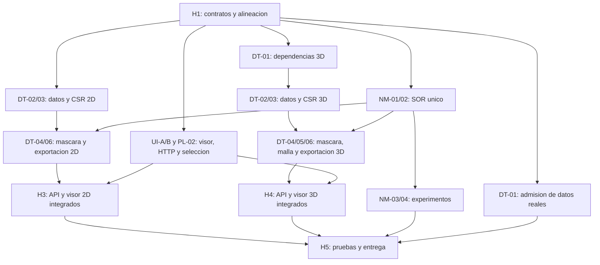

# NeuroVision — Cronograma y distribución del trabajo

**Versión:** 0.2 — línea base de planificación aprobada por el líder\
**Fecha:** 26 de noviembre de 2026\
**Estado:** aprobado por el líder para planificación; pendiente revisión de los responsables, reestimación con los avances y asignación efectiva en Jira.\
**Alcance:** segmentación asistida 2D y 3D, intensidad escalar, Random Walker binario, SOR propio único, cinco capas; exportación básica, experimentación y evidencia académica.

## 1. Base de planificación y restricciones

Fuentes de control: `01_Requisitos.md`, `02_Casos_de_uso.md`, `modelo_matematico.md`, `Anexo_validacion_datos.md`, `04_Arquitectura.md`, `contratos.md`, `plan_pruebas.md` y registro v1.8. El líder ha manifestado conformidad con el plan de pruebas al solicitar continuar. La aprobación es de diseño, no de resultados. La inspección de BRISC e ITK-SNAP y los ejemplos exploratorios no acreditan funcionamiento del producto. La infraestructura aprobada anteriormente se reutiliza; no se reinicia el repositorio.

Se mantienen las tres semanas del plazo original y el presupuesto provisional inicial de 20 h por integrante (80 h-persona). No se conoce la fecha exacta de entrega, ni las horas consumidas/comprometidas de cada persona. Los hitos son relativos al calendario original; no suponen tres semanas adicionales desde hoy. Antes de comprometer fechas, confirmar el saldo individual, disponibilidad y calendario con el equipo. No inventar porcentajes de implementación.

## 2. Esfuerzo restante: escenario de planificación

Las siguientes cifras son una estimación de trabajo restante, optimista para un MVP acotado, incluyendo pruebas junto con cada tarea. No son horas registradas ni una promesa de viabilidad. No se presupone que el presupuesto esté intacto. Se estimará de nuevo tras revisar contratos, dependencias y el primer sistema sintético.

| Integrante | Trabajo estimado (h) | Reserva (h) | Necesidad estimada (h) | Presupuesto inicial (h) | Máximo consumo previo compatible con este escenario (h) |
|---|---:|---:|---:|---:|---:|
| Jherson | 14 | 2 | 16 | 20 | 4 |
| Johan | 15 | 2 | 17 | 20 | 3 |
| Yenderson | 17 | 2 | 19 | 20 | 1 |
| Jennifer | 11 | 2 | 13 | 20 | 7 |
| **Total** | **57** | **8** | **65** | **80** | **15** |

Condición: para cada integrante, saldo = 20 h menos horas consumidas (o presupuesto actualizado acordado). Saldo debe cubrir su necesidad estimada, no basta con que la suma sea suficiente. Las 65 h incluyen 8 h de contingencia y solo contemplan el escenario optimista. La carga de dos capas de Yenderson es especialmente sensible y una revisión de dependencia, conversión, errores de geometría o rendimiento puede superar la reserva. Si el equipo dispone de menos tiempo o el esfuerzo revisado es mayor, recortar extras, simplificar los casos admitidos/ROI y acordar apoyo en pruebas, revisiones y documentación. No transferir responsabilidades, reiniciar horas ni quitar requisitos obligatorios sin decisión expresa. Si sigue sin caber, acordar ajustes de plazo/alcance con el equipo y profesor.

### Confirmación de disponibilidad (por completar con datos reales)

| Integrante | Consumidas | Disponibles | Días/franjas reales | Diferencia saldo - necesidad |
|---|---|---|---|---|
| Jherson | Pendiente | Pendiente | Pendiente | Pendiente |
| Johan | Pendiente | Pendiente | Pendiente | Pendiente |
| Yenderson | Pendiente | Pendiente | Pendiente | Pendiente |
| Jennifer | Pendiente | Pendiente | Pendiente | Pendiente |

## 3. Backlog propuesto por responsable

Los identificadores PL-*, UI-*, DT-* y NM-* son identificadores **locales de planificación**, no claves Jira ni identificadores de pruebas (la columna de verificación usa los del documento 06). Los nombres de ramas son propuestas, desde `develop` actualizado. Una tarea incluye código pertinente, pruebas y evidencia; las tareas de planificación no suponen código funcional. P0 = núcleo/puerta de integración; P1 = validación y entrega. Agrupar PR pequeños coherentes cuando convenga; no crear una rama por método o dimensión. Las dependencias indicadas son de finalización para integrar: se permite preparar pruebas y trabajar con dobles de contrato mientras se completa una dependencia, sin presentar los dobles como resultados del producto.

### 3.1 Jherson — Control y arquitectura

| ID | Trabajo y entregable | h | Depende de | Verificación principal | Rama sugerida |
|---|---|---:|---|---|---|---|
| PL-01 | Revisar contratos con responsables, reconciliar siete documentos con rutas existentes; alinear README/ADR, tipos comunes, eliminar opciones de métodos retirados y ajustar expectativas de tests; verificar accesos/CODEOWNERS/Jira, revisar política de CI. PR de alineación sin solver ficticio. | 2.5 | Aprobación del cronograma y revisión de contratos | AR-01–03, CT-01 (health), contratos afectados | `chore/align-2d-3d-sor-scope` |
| PL-02 | DTO HTTP v2, validación de geometría/ROI/semillas/configuración/identidad, límites finitos de operación y previsualización. | 3.5 | PL-01, DT-02 para integración | CT-01–03/06/07/09/10 | `feat/control-preview-contracts` |
| PL-03 | Orquestación común de segmentación, estados separados, diagnóstico y respuesta; SOR no conoce imágenes; fallos y límites. | 3 | PL-02, DT-03/04, NM-02, DT-05/06 para salida completa | CT-04/05, IN-01/02/03 | `feat/control-segmentation` |
| PL-04 | Evaluar/exportar snapshots, identidad, revalidación, respuestas HTTP y no-store; no repetir SOR. | 2 | PL-03, DT-05/06 | CT-08, IN-04 | `feat/control-results` |
| PL-05 | Integración progresiva, revisión de PR, CI manual final, trazabilidad de aceptación y documentación de ejecución. | 3 | Inicia tras PL-01, cierre con todas las tareas P0/P1 aplicables | IN-01–04, AC-01–04, AR-01–03 | `test/integration-acceptance` |
| | **Subtotal** | **14** | | | |

### 3.2 Johan — Interfaz

| ID | Trabajo y entregable | h | Depende de | Verificación principal | Rama sugerida |
|---|---|---:|---|---|---|---|
| UI-A | Carga local, vista 2D y modelo de sesión con contrato v2; conservar archivo durante sesión, no persistir. | 3 | PL-01, PL-02 para integración | UI-01/06 | `feat/ui-preview` |
| UI-B | ROI 2D/3D, semillas, zoom/pan, navegación axial y coordenadas reversibles; validación de selección y configuración. | 4 | UI-A, geometría del contrato | UI-02/03 | `feat/ui-selection` |
| UI-C | Ejecutar SOR y mostrar máscara/contorno, diagnóstico, gráfica, errores; controlar respuestas obsoletas y separar estados. | 3 | UI-B, PL-03 para integración | UI-04/05/06, AC-01 | `feat/ui-sor-results` |
| UI-D | Visor de malla 3D con Three.js validado; rotar/zoom, escala, malla parcial/no disponible. | 3 | DT-01 (Three.js validado), UI-C, DT-05/PL-03 para integración | UI-04, AC-02 | `feat/ui-mesh-viewer` |
| UI-E | Comparación de ejecuciones por system_id/run_id, evaluación/exportación de la ejecución elegida, manual de interacción y aceptación. | 2 | UI-C/D, PL-04 | UI-07, AC-01/02/04 | `feat/ui-comparison-export` |
| | **Subtotal** | **15** | | | |

### 3.3 Yenderson — Traducción de Datos y Servicios

| ID | Trabajo y entregable | h | Depende de | Verificación principal | Rama sugerida |
|---|---|---:|---|---|---|---|
| DT-01 | Evaluación técnica de NiBabel/scikit-image/Three.js (Johan prueba la última; Jherson revisa lockfiles y CI); admisión de datos: licencia específica, T1C y etiqueta 2, conversión externa MHA→NIfTI y verificación espacial. Registrar bloqueos, separar admisión real de dependencia técnica. | 3 | PL-01 para integrar dependencia; investigación puede adelantarse | Puerta de datos, RNF-05/06/08 | `chore/validate-3d-dependencies` |
| DT-02 | Decodificación escalar 2D/NIfTI, geometría RAS+ según C-01, normalización de ROI, previsualización, rechazo de formatos/afines no admitidos. | 3 | PL-01, dependencias validadas DT-01 para 3D | TR-01–04 | `feat/data-loading-geometry` |
| DT-03 | Grafo 4/6 vecinos, pesos, conectividad, constructor CSR compartido y contexto; orden determinista. | 4 | PL-01, DT-02 para integración | TR-05–07, FX-01/02 | `feat/data-random-walker` |
| DT-04 | Reconstrucción común de probabilidades, máscara y contorno, semillas exactas y exterior no evaluado; resultados no válidos rechazados. | 2 | DT-03, contrato C-03; NM-02 para integración | TR-08, IN-01/02 | `feat/data-reconstruction` |
| DT-05 | Servicios: malla Marching Cubes con afín aplicada una vez, estados de frontera, métricas Dice/IoU y referencias compatibles. | 3 | PL-01, DT-01 (scikit-image), DT-04 para integración | TR-09, SV-01–03 | `feat/services-mesh-metrics` |
| DT-06 | Servicios: gráfica de historial real y exportación CSV/PNG, identidad y casos inválidos. | 2 | PL-01; DT-04/NM-02 para resultados reales | SV-04–06 | `feat/services-exports` |
| | **Subtotal** | **17** | | | |

### 3.4 Jennifer — Métodos Numéricos

| ID | Trabajo y entregable | h | Depende de | Verificación principal | Rama sugerida |
|---|---|---:|---|---|---|---|
| NM-01 | Implementar un único `resolver_sor` con CSR float64, barrido secuencial, x0, omega, tolerancia y diagnóstico. | 4 | PL-01 (contratos lineales aprobados, no datos médicos) | MT-01/02/04 | `feat/sor-solver` |
| NM-02 | Probar casos analíticos, parámetros inválidos, no convergencia/fallo numérico, no mutación e historial; referencia independiente solo en tests. | 3 | NM-01 | MT-01–07, AR-03 | `test/sor-verification` |
| NM-03 | Experimentos de omega/tamaño, medición de recursos y propuesta de valores/límites con equipo; registrar fallos. | 3 | NM-02, DT-03 para escalamiento, admisión de datos para casos reales | MT-08, PF-01/02/04 | `test/sor-benchmarks` |
| NM-04 | Verificación independiente de sistemas pequeños, revisión de oráculos y documentación matemática/limitaciones. | 1 | NM-02; en paralelo a integración | TR-06, IN-01/02, AC-04 | `docs/numerical-evidence` |
| | **Subtotal** | **11** | | | |

PL-01–04, UI-A–D, DT-02–06 y NM-01/02 son trabajo P0 para las funcionalidades esenciales. DT-01 es P0 para dependencias y geometría; la admisión previa a casos reales es una puerta independiente de validación P1. La ausencia de permiso o conversión verificada no impide el desarrollo sintético. PL-05 y UI-E incluyen puertas de aceptación P0 y P1; NM-03/04 incluyen exactitud esencial y evidencia P1. Las tareas de exportación básica son P0; no se omiten al recortar mejoras. No introducir features opcionales en ramas críticas.

## 4. Hitos y orden de integración

| Hito | Puerta de entrada | Entregable verificable / puerta de salida |
|---|---|---|
| H1 — Alineación | Cronograma revisado y disponibilidad contrastada | PR de alineación a develop con contratos revisados por responsables, docs vigentes, tests afectados adaptados, CI todo; dependencias 3D revisadas antes de usarlas, locks reales y pruebas de compatibilidad. Confirmar permisos y reglas de revisión. |
| H2 — Núcleos independientes | Contratos y firmas aprobados | SOR único con FX-01/02 y MT-01–07; construcción CSR y geometría probadas; visor/selección con dobles de DTO; servicios con máscara sintética. No acreditar integración por mocks. |
| H3 — 2D de extremo a extremo | Núcleos 2D integrados en develop | IN-01/03 y AC-01 con constructor real, SOR real, máscara/contorno, diagnóstico, gráfico y exportación básica. |
| H4 — 3D de extremo a extremo | Núcleos 3D probados y mismo SOR | FX-02 analítico y FX-05 volumétrico; IN-02/03 y AC-02, malla obtenida de la máscara calculada, geometría, cortes, interacción y exportación. No sustituir 3D por extrusión ni máscara de referencia. |
| H5 — Validación y entrega | H3/H4 y admisión de datos para experimentos reales | AC-03/04, IN-04, PF-01–04, comparación de omega y métricas con referencia, manual, evidencias de autoría, limitaciones, CI todo del candidato final y PR de promoción si corresponde. |

Hitos objetivo en el plazo original: semana 1, H1/H2; semana 2, H3/H4 con desarrollo paralelo de 3D desde H2; semana 3, H5 y correcciones. No son fechas confirmadas ni nuevas semanas a partir de hoy. Si la semana correspondiente ya transcurrió, replanificar con el calendario real. Cada hito requiere evidencia, no basta con alcanzar su fecha.

### Dependencias esenciales

El grafo es de integración, no de imports. Separar entregas incrementales 2D y 3D dentro de DT-02–06, PL-03/04 y UI-C–E; el 2D no espera al visor 3D ni a la admisión de ITK-SNAP. La ruta de mayor riesgo pasa por dependencias/lectura/geometría 3D → CSR → reconstrucción → malla → API/visor → aceptación. SOR es una dependencia crítica transversal, puede desarrollarse en paralelo a la traducción. La admisión de datos reales se verifica temprano, pero los bloqueos de licencia/conversión no deben detener los fixtures sintéticos.

## 5. Riesgos, límites y acciones de contingencia

| Riesgo | Acción temprana | Decisión ante bloqueo |
|---|---|---|
| Tiempo real insuficiente | Confirmar saldos individuales, ajustar estimaciones al final de H1 y H2 | Reducir extras, acordar apoyo y, si no basta, renegociar con equipo/docente. |
| Doble responsabilidad de Yenderson | Separar Traducción/Servicios por PR; Johan/Jennifer/Jherson colaboran con tests/oráculos y documentación | Priorizar carga, CSR, reconstrucción y malla mínima; no reasignar capa sin acuerdo. |
| Convergencia lenta | CSR, ensayos 8^3/16^3 y 2D pequeño, omega controlado, máximo de iteraciones | Limitar ROI explícitamente; no cambiar solver, no presentar máscara no convergente. |
| Licencia o MHA→NIfTI no verificada | Comprobar uso autorizado, intensidades, etiquetas y geometría al principio | Continuar sintético, buscar caso alternativo autorizado; registrar AC-03 bloqueada. |
| Tipado/compatibilidad de dependencias | Verificar Python 3.13 y Node 22, licencias, stubs, locks y CI completo | Resolver incompatibilidad sin debilitar mypy/lint; reconsiderar dependencia por decisión documentada. |
| Error de coordenadas/identidad | FX-03/04/06, interfaces comunes, tests de endian y snapshot | Bloquear integración afectada y repetir regresiones. |
| Esperas por revisión/CI | PR pequeños, integrar en develop, verificar SHA head/base y cola de PR | Revalidar cuando cambien; no inventar aprobaciones ni bypass no autorizado. |

Excluir de la primera versión: DICOM, IA, persistencia, autenticación, múltiples modalidades simultáneas, vistas multiplanares avanzadas, formatos de exportación adicionales y procesamiento masivo. Mantener ambos modos, malla interactiva, SOR, diagnóstico, exportación básica, controles de calidad y plan de aceptación. Memoria suficiente no prueba rendimiento; límites de carga, iteraciones y transporte se obtienen con evidencia. No fijar omega/ROI de producción por intuición.

## 6. Flujo de trabajo y gestión de tareas

- Confirmar miembros, handles GitHub, CODEOWNERS y membresía exclusiva del equipo con excepción PR-only; verificar Jira existente y su clave antes de crear/relacionar issues. No inventar claves ni revisiones.
- PR inicial sugerido: `chore/align-2d-3d-sor-scope` hacia develop. Reconciliar documentación vigente (evitar duplicados activos), ADR, README, contratos y pruebas; preservar lockfiles y controles. No reescribir evidencias del profesor ni historial. PR de dependencias posterior o separado de forma coherente con el diseño y pruebas, no agregar versiones sin validación.
- Cada tarea real registra descripción, responsable, prioridad, estimación revisada, dependencia, RF/RNF/CU y pruebas, rama, PR y evidencia. Estados propuestos: Pendiente → En curso → En revisión → Validación → Terminado; Bloqueada con motivo visible. Ajustar a los estados de Jira que realmente existan.
- Integrar cada componente por PR a develop, Conventional Commits con autor real, revisión documentada o excepción autorizada comprobada. Ejecutar controles locales y `bash scripts/ci-local.sh todo`. Jherson opera CI remoto manual `workflow_dispatch` desde develop con PR, SHA head de 40 caracteres y `pruebas=todo`; verificar SHA base/head del candidato, todos los jobs y resumen exitoso. Si cambia head/base, revisar y ejecutar de nuevo. CI manual es una puerta humana, no required check automático. Conservar merge commits, promoción a main solo por PR. No modificar remoto ahora.
- Revisión breve de avance compartida al integrar: horas consumidas/restantes, tarea actual, bloqueos, PR/SHA, casos aprobados/fallidos/pendientes. Actualizar plan al cambiar estimaciones o decisiones. Los datos médicos de investigación y referencias permanecen fuera del repositorio público.

## 7. Definición de terminado y paso a implementación

Tarea terminada: contrato satisfecho, pruebas aplicables (incluidos negativos), autoría y PR trazables, evidencia, revisión y CI completo del candidato según la política vigente. Hito terminado: criterios de la sección 4 demostrados; no contar casos planificados como ejecutados. Entrega: ambos modos funcionando con fixtures y datos de investigación sujetos a admisión/disponibilidad, SOR propio, resultados y fallos visibles, métricas cuando referencia compatible, exportación, evidencia de experimentos y manual; limitaciones explícitas. Si un criterio no se cumple, registrar desviación y obtener acuerdo; no certificarlo como superado.

**Puerta de salida del diseño:** aprobar este cronograma como propuesta, confirmar disponibilidad real y revisar contratos con los cuatro responsables. Preparar el PR de alineación; verificar compatibilidad y locks, confirmar CODEOWNERS/Jira y desglosar tareas según el esfuerzo acordado. El trabajo matemático de Jennifer y el resto de componentes podrán avanzar en paralelo una vez compartidos los contratos y aprobada la base. Quedan pendientes las decisiones operativas y de admisión detalladas en los documentos 03–06; se resolverán con evidencia antes de las funcionalidades dependientes.

No se han modificado GitHub ni Jira, instalado dependencias, convertido datos ni ejecutado nuevas pruebas en esta etapa. Horas, ramas, identificadores locales y secuencia son propuestas de planificación, no compromisos confirmados.

## 8. Reconciliación previa a H1 (26 de noviembre de 2026)

El líder aprueba la propuesta de cronograma. La revisión remota de solo lectura detectó tres ramas de trabajo y el PR #3 abierto. La base `develop` continúa en `3f9d65c34d868721876e4a8308dd2e55153dc632`. Aplicar `Anexo_reconciliacion_H1.md` antes de integrar cambios: conservar los commits y el trabajo útil, ajustar las discrepancias respecto de C-01–09 y revisar pruebas. No considerar las 65 h una nueva estimación validada ni descontar tareas automáticamente por la mera existencia de commits. Los identificadores y ramas de las tablas siguen siendo propuestas; reutilizar ramas existentes cuando corresponda, sin duplicar tareas ni reescribir historial.
