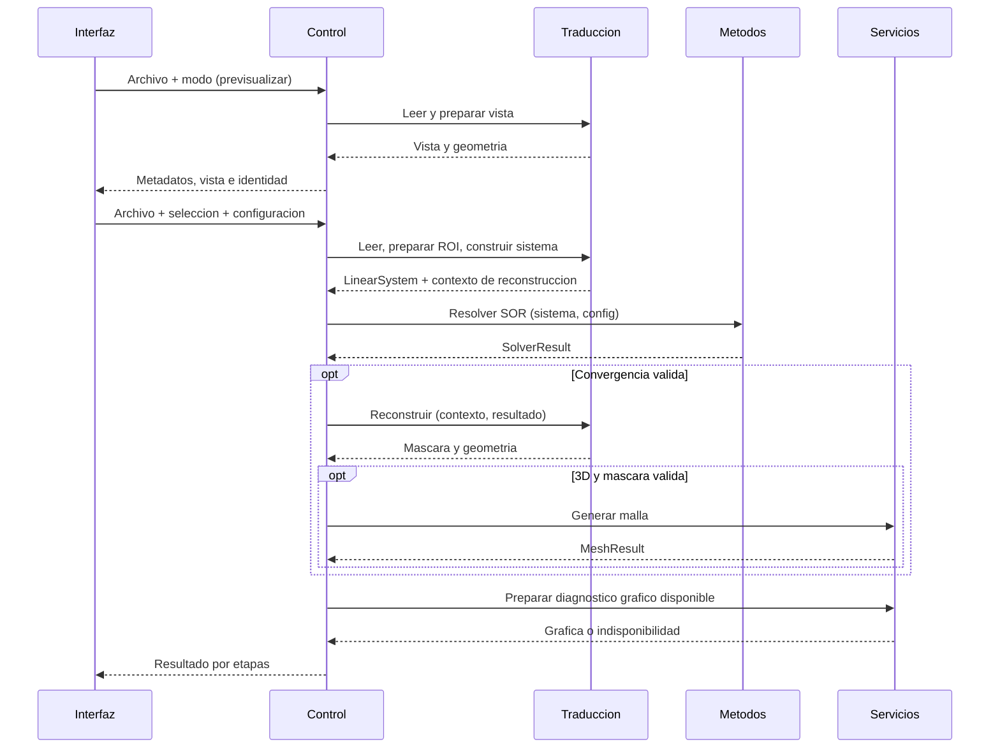

# NeuroVision — Contratos entre las cinco capas

**Versión:** 0.2 — línea base de interfaces aprobada por el líder; validaciones pendientes\
**Fecha:** 25 de noviembre de 2026\
**Alcance:** 2D y 3D escalares; Random Walker binario; SOR propio único; cinco capas\
**Estado:** diseño aprobado por el líder en conversación; no código implementado ni evidencia de pruebas ejecutadas.

**Control de aprobación (D-09).** El líder manifestó su conformidad con los contratos C-01 a C-09 y solicitó continuar. Se conserva el contenido técnico como línea base de diseño. La aprobación no equivale a revisión individual de los cuatro responsables, validación de dependencias, geometría, recursos, admisión de datos o fijación definitiva de parámetros. La versión de documento 0.2 no cambia el esquema HTTP `contract_version: "2"`.

## 1. Base de diseño y reglas de dependencia

Fuentes: `01_Requisitos.md` (RF-01–14, RNF-01–10), `02_Casos_de_uso.md` (CU-01–05, RC-01–10), `modelo_matematico.md`, `Anexo_validacion_datos.md`, `04_Arquitectura.md` y `03_Registro_de_decisiones_v1.6.md`. Los documentos de requisitos, casos de uso y arquitectura son líneas base aprobadas por el líder; la formulación matemática está aceptada como enfoque, con decisiones y validaciones técnicas pendientes. Las firmas, políticas y formatos son decisiones de diseño aceptadas como línea base por el líder, sujetas a comprobación, no nuevas exigencias del profesor.

Control (Jherson) llama exclusivamente a `api_publica.py` de Traducción (Yenderson), Métodos (Jennifer) y Servicios (Yenderson); estas capas son hermanas independientes. Interfaz (Johan) llama a Control por HTTP. Los tipos internos Python viven en `contratos/`; las DTO Pydantic de transporte en Control, con equivalentes TypeScript en `capa_1_interfaz/src/shared/types/contracts.ts`. Los contratos no son una sexta capa ni ejecutan casos de uso. No se transmiten CSR ni instancias Python al navegador. Se conserva el stack y la calidad del repositorio.



## 2. Convenciones comunes (C-01)

| Aspecto | Convención propuesta |
|---|---|
| Modo | `2d` o `3d` (discriminador obligatorio); no inferirlo solo por extensión. |
| Intensidad | Una modalidad, un escalar por posición, sin eje de canales. Tras preparación, float32 finito en [0,1]. |
| Álgebra | A, b, x y operaciones de SOR en float64; A `scipy.sparse.csr_array` canónica. |
| Máscara | `bool` interna, valores 0/1 en transporte; no confundir etiquetas de referencia con probabilidades. |
| Coordenadas | Enteros, base 0; límites inferiores inclusivos y superiores exclusivos. Rechazar booleanos como enteros. |
| 2D | Arreglo `(height,width)` indexado `[y,x]`; selección externa `(x,y)`; origen arriba-izquierda. |
| 3D | Arreglo de trabajo `(ni,nj,nk)` indexado `[i,j,k]`; selección externa `(i,j,k)`; reorientación registrada. |
| Orden lineal | Orden C: 2D `y*width+x`; 3D `(i*nj+j)*nk+k`. Aplicar al dominio local de ROI para construir el sistema. |
| Semillas | `foreground`=1; `background`=0. Posiciones únicas, ambas clases; nunca coordenadas de pantalla ni de un modelo 3D. |
| Unidades | Segundos en tiempos internos y API; mm en geometría física 3D admitida. No inferir mm en JPEG/PNG. |
| Salidas | No mutar los arreglos de entrada de otra capa; no depender de variables globales mutables. `frozen=True` no hace inmutables los ndarray: documentar propiedad y evitar alias que permitan modificar A/b; el solver copia x0. |

### 2.1. Geometría del dominio de trabajo

2D: decodificación determinista sin reescalado ni interpolación. Propuesta inicial: aceptar orientación EXIF ausente o identidad; si se detecta otra orientación, rechazar con explicación hasta implementar una transformación explícita compatible con la referencia. `width,height` siempre corresponden al dominio decodificado, no al canvas ni a la ROI.

3D: admitir NIfTI escalar exactamente 3D (.nii/.nii.gz), con escala de intensidades del encabezado aplicada, afín válida, unidades espaciales conocidas y geometría compatible. Propuesta conservadora inicial: volúmenes con ejes ortogonales, alineados con los ejes anatómicos, espaciamiento isotrópico; reorientar a RAS+ por permutaciones/inversiones sin interpolación. Rechazar datos 4D, oblicuos, cizallados, anisotrópicos o con información espacial no verificable hasta validar una política ampliada. NiBabel y la política de selección de afín (sform/qform y discrepancias) requieren pruebas: no escoger silenciosamente una afín cuando ambas codifican espacios incompatibles; rechazar la ambigüedad. Si existe una sola afín válida, documentar su procedencia. Valores de tolerancia geométrica y umbral de no singularidad se acuerdan mediante pruebas antes de admitir datos reales; no comparar floats de manera arbitraria. Las unidades conocidas distintas de mm solo se admitirán después de validar su conversión; para el piloto exigir mm.

Conservar `H_original`, `H_work` (4x4 float64), `T_work_to_original` (transformación entera afín que realiza la permutación/inversión de índices) y ambas formas. Exigir `H_work = H_original @ T_work_to_original` dentro de tolerancia validada, bloque espacial no singular, finitud y última fila [0,0,0,1]. El visor axial muestra `volume[:,:,k].T` como imagen [fila j,columna i], x=i e y=j creciente hacia abajo. Etiquetar orientación de acuerdo con el espacio RAS+, sin asumir convención radiológica. Si se cambia presentación, debe existir transformación inversa y prueba de ida/vuelta. Nunca etiquetar un plano no axial como axial.

ROI: selecciones en coordenadas de trabajo antes del recorte. La coordenada local es la global menos el origen de ROI; registrar este origen. Un cambio de zoom, pan o corte no cambia semillas ni geometría. El contorno/mascara/malla se limitan a la región calculada: exterior no evaluado ≠ fondo calculado.

Ejemplo 2D: ROI `[20,60)×[10,50)`, semilla (34,25) → local (14,15) y posición plana 614. Ejemplo 3D: ROI i=[10,14), j=[20,25), k=[30,36), semilla (12,23,34) → local (2,3,4), posición plana `(2*5+3)*6+4=82`. Estos números son posiciones de la cuadrícula local, no necesariamente filas de A.

## 3. Contratos de datos y preparación — Traducción (C-02)

Los nombres son propuestas para los módulos existentes de `contratos/`, con `volumen.py` y `geometria.py` como ampliaciones posibles. Usar dataclasses con validación estructural coherente con el esqueleto. Las validaciones que requieren archivos, imagen, grafo o varias entidades pertenecen a su capa responsable, no a un tipo genérico.

| Tipo | Campos mínimos / forma | Invariantes |
|---|---|---|
| `InputGeometry` | mode, original_shape, work_shape, source_format; en 3D H_original, H_work, T_work_to_original, spacing_mm, axis_codes, affine_source | Forma y transformación válidas; 2D sin afín física inventada. |
| `DecodedData` | geometry, intensities, source_digest | Array escalar 2D/3D en dominio de trabajo, valores originales decodificados finitos; convertir a float64 al preparar sin perder información relevante; no uint8 para calcular NIfTI. |
| `ImageData` (existente) | pixels float32 `(h,w)`, source_format, normalization | Conservar validación [0,1]. Es un arreglo ya preparado, no el archivo bruto; dimensiones derivadas de la porción representada. |
| `VolumeData` | voxels float32 `(ni,nj,nk)`, source_format, normalization, geometry | Análogo 3D, con geometría de dominio explícita. La geometría incluye origen si se trata de un recorte. |
| `ROISelection` (existente) | x_min,y_min,x_max,y_max | Rectángulo positivo. |
| `ROI3DSelection` | i_min,j_min,k_min,i_max,j_max,k_max | Cuboide positivo. |
| `Seed` / `Seed3D` | x,y o i,j,k; `SeedLabel` común | Coordenadas no negativas; etiqueta estricta. |
| `SeedSelection` / `Seed3DSelection` | tupla de semillas de la dimensión correspondiente | Posiciones únicas, ambas clases. |
| `PreparedROI` | geometry, roi, normalized (ImageData/VolumeData), normalization_record, seed_flat_indices, seed_values | Forma coincide con ROI; semillas se convierten al índice local exactamente una vez; al menos una incógnita. |
| `ModelConfig` | beta, threshold, política de frontera y pesos con identificador de versión | beta finito >=0; umbral estrictamente entre 0 y 1 para preservar semillas; conectividad derivada del modo, no configurable arbitrariamente. |
| `ReconstructionContext` | geometry, roi, shape, seed_flat_indices, seed_values, unknown_flat_indices, normalization_record, model_config | Partición completa disjunta de posiciones locales; índices int64 ordenados C, correspondencia fila↔incógnita inequívoca. Sin imagen médica en contratos del solver. |
| `SystemBuildResult` | system: LinearSystem, context: ReconstructionContext, system_digest | n = número de incógnitas, misma enumeración de filas y columnas; sin alias mutable que cambie el sistema durante una comparación. |
| `PreviewData` | geometry, uint8_view, display_min, display_max, input_id, preparation_version | Forma de trabajo completa y finita; solo para visualizar; no es entrada matemática. |

**Admisión 2D.** JPEG/PNG gris; aceptar RGB únicamente si los tres canales decodificados son idénticos en todas las posiciones; reducir a un canal sin pérdida. Rechazar color verdadero, alfa o modo/paleta no admitido en el MVP, informando motivo. BRISC ya inspeccionado presenta 2.866 JPEG L y 1.927 RGB acromáticos en segmentación; no asumir lo mismo de todos los archivos futuros. Comprobar formato real, tamaño decodificado y finitud; no confiar en extensión o MIME. La referencia sigue un lector separado.

**Admisión 3D.** MHA no forma parte del producto mínimo; convertir el caso ITK-SNAP T1C y su referencia externamente preservando cuadrícula, valores y afín. Verificar geometría y correspondencia de etiquetas tras conversión; no interpolar máscaras. No se ha realizado ni aprobado la conversión, ni se han cerrado licencias. El producto no fusiona las cuatro secuencias.

**Normalización del cálculo.** Propuesta min–max dentro de toda la ROI, en ambos modos, con diferencias float64 y salida float32: g=(I−min)/(max−min). Si el rango es cero, g=0 y advertencia `CONSTANT_INTENSITY`; el modelo depende entonces de geometría/semillas. Guardar política, mínimo y máximo. No normalizar cada corte del volumen por separado, no usar la vista uint8 como entrada. Para previsualización se aplica una transformación independiente documentada a uint8 (min–max del dominio de trabajo; constante→0), sin modificar los datos originales. El umbral candidato de segmentación es 0.5 con empate a primer plano; beta y margen de redondeo de probabilidades pendientes de pruebas. Los valores de beta y omega se indican explícitamente en la ejecución hasta elegir defaults por experimentos.

**Construcción.** Vecinos inmediatos 4/6, sin diagonales, periódicas ni conexiones fuera de ROI. No fijar el borde a fondo sin semillas. `w=exp(-beta*(g_i-g_j)^2)` con pesos calculados una sola vez por arista y usados simétricamente. Se exige positividad efectiva y sumas finitas; comprobar conectividad de cada componente de incógnitas a semillas y diagonal positiva; no regularizar ni recortar pesos silenciosamente. Para el dominio anisotrópico futuro, el factor espacial candidato del modelo requiere validación específica. Construir A=L_UU y b=-L_UM p_M directamente en CSR; no formar un Laplaciano denso. A tiene como máximo 5n elementos no nulos en 2D o 7n en 3D. El contrato estructural de A no demuestra SPD universal; la garantía matemática es del constructor bajo sus condiciones y debe verificarse con fixtures.

## 4. Contratos de Métodos Numéricos — Jennifer (C-03)

### 4.1. `LinearSystem` (reutilizar)

`A: scipy.sparse.csr_array`, `b: NDArray[float64]`. A cuadrada de dimensión n>0, CSR canónica (índices ordenados, sin duplicados; eliminar ceros explícitos al construir), A y b finitos float64, b de forma (n,), diagonal estrictamente positiva. Verificar índices válidos y dimensiones; no mutar sistema. El solver acepta sistemas lineales sin conocer imagen, modo, ROI, semillas, NIfTI, HTTP ni UI. SPD es precondición de la garantía de convergencia, no resultado de un test estructural. Usar casos de referencia pequeños para verificar SPD y exactitud; no ejecutar un solucionador externo durante el producto.

### 4.2. `SolverConfig` (adaptar)

| Campo | Tipo y política propuesta |
|---|---|
| `method` | `SolverMethod.SOR` únicamente, valor `sor`. Conservar enum de un solo valor para trazabilidad y migración; no selector de métodos en UI. |
| `omega` | float finito obligatorio, 0<omega<2 (estricto). Probar 0.8,1.0,1.2,1.5,1.8,1.9 inicialmente; omega=1 es una configuración del mismo SOR, no otro solver. |
| `rtol` | float finito >=0; 1e-6 provisional heredado. |
| `atol` | float finito >=0; 1e-10 provisional heredado. |
| `max_iterations` | int positivo no booleano; 2000 provisional, sujeto a política de recursos. |
| `x0` | None (vector cero) o vector float64 finito de longitud n, únicamente interfaz interna. El MVP HTTP emplea cero y registra `initialization: zero`; no envía vectores arbitrarios. |

Al menos una tolerancia positiva; el umbral efectivo `tau=max(atol,rtol*norm(b,2))` debe ser finito y estrictamente positivo. Si b=0 y atol=0, rechazar configuración efectiva. No usar el residuo relativo como división por cero. Validar x0 antes de iterar. La política HTTP puede exigir parámetros explícitos y limitar sus rangos de recursos; los valores heredados son para pruebas iniciales, no promesas de rendimiento. SOR actualiza en orden creciente de filas con las componentes ya actualizadas; calcular el residuo verdadero antes del primer barrido y después de cada barrido completo. No recortar los iterados.

### 4.3. `SolverResult` (adaptar, fallo explícito)

Campos: method=`sor`; status `CONVERGED` | `MAX_ITERATIONS` | `NUMERICAL_FAILURE`; solution float64 vector (n,) o None; iterations y sweeps int >=0; initial_residual y final_residual float no negativo o None; residual_history tupla de floats finitos >=0; elapsed_seconds float finito >=0; omega_used, rtol, atol, max_iterations, stopping_threshold (float finito positivo cuando el sistema fue aceptado); initialization; failure_code opcional; failed_at_sweep opcional.

- Precondición inválida (estructura, x0, tau): error tipado de contrato/configuración, no fabricar `SolverResult` convergente ni residuo. Tiempo se mide con reloj monotónico alrededor de la ejecución numérica, no incluye I/O de imágenes, construcción ni malla.
- `iterations=sweeps`: número de barridos terminados **y evaluados con residuo finito**. Historial incluye r0 más un valor por barrido registrado. Si el cálculo falla en el barrido/residuo siguiente, `failed_at_sweep=iterations+1`; no contar ese intento como barrido evaluado. Registrar el fallo aunque haya habido actualizaciones parciales. Un fallo al calcular el residuo inicial admite historial vacío, initial/final=None, iterations=sweeps=0, failed_at_sweep=None. En otro caso initial y final son exactamente el primero y el último del historial disponible; nunca insertar NaN o 0 para simular un residuo desconocido.
- `CONVERGED`: historial no vacío, final<=tau, solución finita de forma (n,), incluye posible cero iteraciones. SOR no declara pertenencia a [0,1] ni calidad de segmentación.
- `MAX_ITERATIONS`: iterations=max_iterations, final>tau, solution=None para esta política de producto; historial completo. Convergencia en el último barrido se clasifica como CONVERGED.
- `NUMERICAL_FAILURE`: evidencia finita disponible, failure_code y solution=None; no presentar aproximación inválida como máscara. Si el residuo inicial no se puede evaluar, explicitarlo. No inventar historial ni tiempos. `omega_used` y configuración siempre corresponden a la ejecución real.

### 4.4. API pública de la capa

Firma lógica (no implementación): `resolver_sor(system: LinearSystem, config: SolverConfig) -> SolverResult`. No añadir parámetros mode, imagen, beta, threshold, seeds, HTTP o servicios gráficos. La misma función resuelve los casos 2D y 3D y los sistemas sintéticos independientes. Los tipos compartidos se importan desde `contratos/`; no importar Traducción ni Servicios.

Caso mínimo para verificar: A=[[2,-1],[-1,2]], b=[0,1]; solución [1/3,2/3]. A se almacena CSR en pruebas. La aceptación numérica requiere comprobar residuo sobre A,b originales y error contra la solución conocida. No se afirma que el solver del producto esté escrito.

## 5. Reconstrucción de resultados — Traducción (C-04)

`SegmentationResult` 2D y `VolumeSegmentationResult` 3D: geometry, roi, threshold, probability_map (float64 finito), mask (bool), boundary_mask (solo 2D), solver_result, touches_boundary, warnings. La forma de las matrices coincide con la ROI; no rellenar dominio externo como fondo. La máscara se obtiene solo tras estado CONVERGED y verificación de longitud y correspondencia fila↔posición. Restaurar exactamente semillas 0/1. Verificar valores en [0,1], permitiendo únicamente una corrección diminuta de redondeo según margen que se fijará con pruebas y se registrará; no alterar la solución numérica original. Un valor materialmente fuera de rango implica error de reconstrucción aun con residuo suficiente. Umbral candidato >=0.5, foreground=1. Contorno 2D: marcar píxel foreground que tiene vecino ortogonal background dentro de ROI; detectar contacto con frontera por separado. Para el MVP no introducir fondo ficticio fuera de ROI; mostrar contorno y superposición con origen correcto.

Firma lógica `reconstruir(context: ReconstructionContext, result: SolverResult) -> SegmentationResult | VolumeSegmentationResult` exige CONVERGED; en caso contrario Control no llama a esta función. Errores de reconstrucción tipados; conservar el SolverResult real, no una máscara ficticia. Para 3D mostrar cortes de la máscara usando los mismos ejes que la vista y el origen de ROI. El mapa de probabilidades es interno y no representa probabilidad clínica; para el MVP no es necesario transmitirlo completo por HTTP.

## 6. Contratos de Servicios — Yenderson (C-05)

| Operación pública propuesta | Entrada | Salida |
|---|---|---|
| `generar_malla` | VolumeSegmentationResult válido | MeshResult |
| `calcular_metricas` | máscara válida y referencia binaria alineada, contexto de evaluación | MetricsResult |
| `generar_grafica` | SolverResult | ExportResult PNG (o indisponibilidad explícita) |
| `exportar_numerico` | resumen de ejecución y diagnóstico, métricas si existen | ExportResult CSV |
| `exportar_imagen` | vista original uint8 del corte, máscara/contorno y origen, metadatos | ExportResult PNG |

`MeshData`: vertices `(m,3)` float64 finitos internos, faces `(f,3)` enteros de índices válidos base 0, espacio `RAS+`, unidad `mm`, `touches_boundary` y advertencias. `MeshResult.status`: `OK`, `PARTIAL`, `UNAVAILABLE`, `FAILED`; solo OK/PARTIAL contienen malla no vacía y válida, PARTIAL indica contacto/truncamiento. Marching Cubes sobre máscara binaria nivel 0.5, spacing unitario y sin rellenar artificialmente un exterior no evaluado. Aplicar a cada vértice local v la transformación H_work @ [v+origen_roi,1]; no duplicar espaciado; compensar cualquier desplazamiento auxiliar explícito. Verificar finitud, rango de índices, triángulos no degenerados, orientación de caras/normales y escala; respetar la convención de ejes al convertir para presentación. Si no hay cruce de nivel, tamaño insuficiente, máscara vacía o no hay malla válida, UNAVAILABLE con motivo. Si toca frontera, ofrecer superficie abierta parcial cuando sea válida o declarar indisponible; no inventar tapas. Un error de extracción no elimina una máscara válida. `PARTIAL` no equivale a volumen completo del tumor. Sin malla válida no se considera completado RF-10 para ese caso. Three.js puede centrar cámara o transformar visualmente el modelo sin cambiar los datos físicos exportables.

`MetricsResult`: mode, domain=`roi`, reference_id, reference_policy, foreground_count, reference_count, true_positives, false_positives, false_negatives (enteros no negativos), dice e iou (float [0,1] o None), optional `volume_mm3` si geometría física válida y se decide incluirlo. Mantener `foreground_pixels` antiguo solo si existe compatibilidad deliberada; usar `foreground_count` común en nueva versión. Dice=2TP/(2TP+FP+FN), IoU=TP/(TP+FP+FN); ambos vacíos→None, no 1 inventado. Los conteos y las métricas abarcan únicamente la ROI evaluada; advertir que puede excluir parte del tumor. Si se incluye volumen: count*abs(det(B)) dentro de ROI; no inferir volumen total ni área física 2D.

**Referencia**: Traducción decodifica y verifica geometría y mapeo con el mismo dominio de trabajo, Control valida asociación/procedencia y semántica; Servicios recibe arreglos ya alineados. No confiar solo en tamaños. Para BRISC utilizar el par autorizado con mismo basename/manifest y dimensiones/orientación verificadas; valores observados 0–10 y 246–255, regla propuesta >=128 para esas máscaras; rechazar otras semánticas no verificadas. Para el piloto ITK-SNAP utilizar etiqueta 2 (tumor activo) como primer plano, 0/1 como resto; comprobar que las etiquetas se conservan tras conversión. No inferir pertenencia al mismo paciente de dimensiones o hash; requerir emparejamiento documentado y confirmado. En 3D exigir mismo espacio/cuadrícula tras transformaciones por permutación/inversión comprobadas; no remuestrear en MVP. Alinear y recortar la referencia exactamente a la ROI sin modificar la máscara calculada. Ausencia/incompatibilidad no afecta segmentación, solo evaluación. La referencia no se usa para semillas, ROI, normalización, A,b ni producción de máscara.

`ExportResult` existente: filename seguro, media_type y content bytes. CSV UTF-8 (`text/csv`) con columnas documentadas: run_id, system_id, mode, omega, rtol, atol, max_iterations, initialization, beta, threshold, status, stopping_threshold, sweeps, elapsed_seconds, iteration, residual, dice, iou y dominio; una fila por entrada de historial, o fila de diagnóstico con iteration/residual vacíos cuando no existe historial. Incluir metadatos ROI, semillas, versión de preparación/modelo y código cuando estén disponibles, en columnas JSON compactas escapadas correctamente. Ausencias como celdas vacías; nunca sustituir por cero. Identificadores técnicos no identificadores personales; impedir inyección de fórmulas CSV en campos externos. PNG de gráfica generada a partir del historial real, con eje iteración y residuo (escala lineal inicial para representar cero); advertencia en historial vacío. PNG de corte procesado conserva imagen original de vista y superposición solo dentro de ROI; identifica índice de corte k en 3D y ejecución en nombre/metadatos, no se denomina volumen a un corte. No exportar imagen segmentada válida de ejecución fallida. No es necesario exportar STL, NIfTI ni persistir archivos para RF-14 mínimo.

## 7. APIs públicas y orden de integración (C-06)

| Capa | Firmas lógicas propuestas en `api_publica.py` |
|---|---|
| Traducción | `leer_datos(content, mode) -> DecodedData`; `previsualizar(data) -> PreviewData`; `preparar_roi(data, selection) -> PreparedROI`; `construir_sistema(prepared, model_config) -> SystemBuildResult`; `reconstruir(context, result) -> SegmentationResult | VolumeSegmentationResult`; `preparar_referencia(reference_content, data_geometry, roi, reference_policy) -> AlignedReference` |
| Métodos | `resolver_sor(system, config) -> SolverResult` |
| Servicios | Operaciones de sección 6; sin dependencia de Traducción ni Métodos. |

`content` representa bytes o una entrada temporal acotada de propiedad de la solicitud, sin almacenar rutas arbitrarias enviadas por cliente. La firma concreta de lectura de archivos (stream o bytes) debe respetar los límites antes de asignar memoria; preferir interfaz simple para fixtures pequeños. Control valida composición (ROI/semillas/límites, modo, configuración), revalida identidad, coordina llamada tras llamada y adapta tipos a HTTP. Capas especializadas validan sus entradas y emiten errores propios tipados; no importan excepciones HTTP. Para mock de integración utilizar estas mismas firmas y contratos, no inventar solver temporal en Control. No ejecutar la siguiente etapa si su precondición no se cumple.

## 8. Contrato HTTP v2 — propuesta (C-07)

Conservar `/api/v1/health` existente y prefijo `/api/v1/` para las nuevas operaciones (versión de rutas). Usar `contract_version: "2"` en DTO nuevas para distinguir el esquema incompatible de la selección 2D anterior `"1"`; son versiones distintas (ruta y payload). Rechazar DTO de versión no soportada, no asumir compatibilidad. `GET /api/v1/health` no cambia. `POST` procesa una solicitud síncrona, no crea tareas en background. FastAPI con operación CPU-bound fuera del event loop, concurrencia acotada y limpieza de temporales incluso ante error. No prometer cancelación si el cliente deja de esperar.

| Ruta propuesta | Petición | Respuesta exitosa |
|---|---|---|
| POST `/api/v1/previsualizar` | multipart: `image` original, `request` JSON {contract_version, mode} | JSON con PreviewDTO y dominio de trabajo |
| POST `/api/v1/segmentar` | multipart: `image` original, `request` JSON SegmentRequest | JSON RunResultDTO por etapas |
| POST `/api/v1/evaluar` | multipart: `image` original, `reference`, `request` JSON con snapshot de resultado, reference_policy y asociación documentada | JSON MetricsDTO con run_id y dominio |
| POST `/api/v1/exportar` | multipart: `request` JSON con snapshot de resultado, export_kind (`numeric_csv` o `processed_png`); `image` original y `slice_index` requeridos para PNG 3D; `image` requerido para PNG 2D | bytes CSV/PNG, Content-Type y Content-Disposition attachment seguro |

La arquitectura no prevé persistencia. El navegador conserva el `File` original, previsualización, selecciones y snapshots inmutables de ejecuciones en memoria. Se libera al cambiar caso o cerrar sesión según política de retención; no usar localStorage, IndexedDB ni cache HTTP de datos médicos. Para evaluación/exportación, el cliente reenvía datos necesarios; no se llama de nuevo a SOR. En evaluación y PNG, el servidor vuelve a leer el original, comprueba identidad y geometría. En CSV no necesita original; valida estructura y exporta el diagnóstico que recibe, no afirma verificar que fue producido por el servidor. No incluir imágenes médicas, rutas, nombres de paciente ni hashes de casos en logs públicos. Respuestas sensibles `Cache-Control: no-store`. No exponer la aplicación públicamente como servicio clínico.

### 8.1. Identidad y correspondencia

`input_id`: SHA-256 del contenido original en hex minúsculo (64 chars), junto con mode y `preparation_version`. Identidad de dominio: forma de trabajo, geometría y versión; Control la verifica de nuevo con el archivo. No es prueba de paciente, autorización ni autenticidad de resultados. `system_id`: SHA-256 de representación canónica de n, CSR (indptr, indices int64, data float64), b float64, en orden C little-endian con etiquetas/longitudes no ambiguas; fijar serialización en prueba de contrato (hash en backend, no calcula el frontend). Permite identificar A,b idénticos en comparaciones dentro del mismo formato/versionado. Congelar construcción, ROI, semillas, parámetros de modelo, x0, tolerancias, máximo y orden; variar solo omega para comparación controlada. Versionar el modelo/preparación y registrar versión de código; misma identidad de sistema no implica mismo tiempo en otro hardware. `run_id`: UUID aleatorio generado por Control para cada ejecución; `request_id` UUID del cliente para descartar respuestas obsoletas y asociar la solicitud exacta, no se usa para autorización. Cambios de archivo/ROI/semillas/parámetros invalidan la asociación con el resultado actual, pero pueden conservarse ejecuciones identificadas para comparación; nunca mostrar una anterior como nueva. Un hash no sustituye el archivo ni prueba origen del snapshot reenviado.

### 8.2. DTO y codificación

Propuesta simple: JSON con arrays grandes en Base64 de bytes contiguos. No añadir un protocolo ni dependencia de compresión nuevos. Tipo `ArrayDTO {dtype,shape,order,encoding,data}`: dtype `uint8`, `float32_le` o `uint32_le`, order `C`, encoding `base64`, shape enteros positivos; longitud de bytes exacta = producto de dimensiones × bytes por elemento. Validar formato Base64, tamaño codificado/decodificado antes de asignar, dimensiones, dtype, finitud de vértices, rango de índices, máscaras 0/1; no enviar NaN/Infinity en JSON. uint8 para vistas/máscaras/contorno; malla float32 en transporte (verificar que conversión desde float64 mantiene precisión geométrica acordada), caras uint32. Si una malla no se puede representar con precisión o excede límite de respuesta, informar fallo/indisponibilidad sin truncar silenciosamente. Probabilidades permanecen internas. No enviar CSR. `ImageGeometryDTO`: mode, original_shape, work_shape, en 3D H_original, H_work, T_work_to_original, spacing_mm, units, axis_codes, affine_source. Las matrices afines son pequeñas listas 4x4 de números JSON. `PreviewDTO`: contract_version, input_id, preparation_version, geometry, view:ArrayDTO uint8, display_min/max, warnings. Para el piloto de 6.082.560 vóxeles, una vista uint8 cruda ocupa 6.082.560 bytes y su Base64 8.110.080 bytes, sin contar JSON ni copias de memoria; validar viabilidad real. Si no resulta viable, se acordará otro transporte/estrategia sin alterar datos matemáticos. No imponer una caché nueva como solución sin acuerdo.

Ejemplo de `SegmentRequest` 2D (JSON ilustrativo; no es una petición real ni un hash/UUID de ejecución):

```json
{
  "contract_version": "2",
  "request_id": "00000000-0000-4000-8000-000000000001",
  "mode": "2d",
  "input_id": "0000000000000000000000000000000000000000000000000000000000000000",
  "preparation_version": "1",
  "work_shape": [2, 2],
  "roi": {"x_min": 0, "y_min": 0, "x_max": 2, "y_max": 2},
  "seeds": [{"x": 0, "y": 0, "label": "background"}, {"x": 1, "y": 0, "label": "foreground"}],
  "model": {"beta": 0, "threshold": 0.5},
  "solver": {"omega": 1.2, "rtol": 0.000001, "atol": 0.0000000001, "max_iterations": 2000}
}
```

El ejemplo usa beta=0 y omega=1.2 para verificar el sistema uniforme, no como defaults de resonancias. En 3D cambiar mode, work_shape a [ni,nj,nk], ROI a i/j/k_min/max y semillas a i,j,k,label. `mode` discrimina DTO estrictas; no aceptar campos mezclados ni desconocidos. `model` solo admite beta/threshold dentro de política validada; conectividad/frontera/normalización se derivan del modo y versión, quedan registradas en configuración efectiva. `method` se deriva como `sor` por Control. Pydantic valida JSON y tipos; backend reconstruye y verifica dimensiones a partir de la decodificación. Los parámetros no pueden sustituir reglas matemáticas ni límites del servidor.

`RunResultDTO`: contract_version, request_id, run_id, input_id, preparation_version, system_id, geometry, roi, seeds, effective_model, effective_solver, normalization_record, solver (diagnóstico de sección 4, sin vector solution), reconstruction (status `OK`/`NOT_RUN`/`FAILED`, máscara y contorno opcionales, touches_boundary, warnings), mesh (status `OK`/`PARTIAL`/`UNAVAILABLE`/`FAILED`/`NOT_APPLICABLE`/`NOT_RUN`, vertices y faces opcionales, frame y units), graph (status `OK`/`UNAVAILABLE`/`FAILED`, PNG Base64 opcional), errors y warnings (por etapa, código y mensaje). `effective_*` registra reglas y parámetros realmente usados. Si no hay solver válido, ninguna máscara ni malla válida. Modo 2D usa mesh NOT_APPLICABLE. En no convergencia, reconstruction/mesh 3D NOT_RUN; en fallo de reconstrucción, conservar diagnóstico, mesh NOT_RUN. En fallo de malla conservar máscara y explicar estado. No utilizar un `success` booleano global ambiguo.

`RunSnapshotDTO` (para evaluación/exportación): subconjunto de RunResultDTO con identidad, configuración efectiva, geometry, roi, seeds, diagnóstico, estado de reconstrucción y máscara/contorno si válidos; no reenviar vértices ni PNG de gráfica. Para CSV pueden incluirse métricas ya obtenidas, identificadas por run_id/referencia y dominio, con validación estructural; no exigir máscara cuando solo se exporta diagnóstico. Para evaluación/PNG exigir solver CONVERGED y reconstrucción OK, máscara coherente, semillas preservadas, forma y dominio correctos; verificar origen/archivo cuando es necesario. `reference_policy` inicialmente enum de las dos políticas del piloto (BRISC_BIN_128, ITKSNAP_LABEL_2); confirmar autorización y emparejamiento antes de comparar. `MetricsDTO` incluye run_id, referencia/semántica y dominio, conteos, dice e iou nullable. Como el backend no conserva resultado autoritativo ni firma snapshots, solo puede verificar coherencia de lo reenviado; no garantiza autenticidad frente a cliente modificado. MVP local/educativo, no certificación. Si se necesita integridad autenticada, requiere decisión nueva; no prometerla mediante un UUID o hash.

## 9. Errores y estados (C-08)

Propuesta de error HTTP uniforme: `{"contract_version":"2","error":{"code":"INVALID_ROI","stage":"selection","message":"La ROI excede las dimensiones.","request_id":null}}`. request_id cuando disponible; mensaje comprensible en español, sin traceback ni datos de archivos. Adaptar también errores de validación Pydantic sin filtrar contenidos sensibles. Las capas especializadas devuelven/propagan errores tipados de dominio; Control los mapea a HTTP. No lanzar HTTPException desde Métodos o Traducción/Servicios. `RunResultDTO.errors` conserva los mismos campos de etapa/código/mensaje para fallos esperados después de construir el sistema.

| HTTP | Códigos propuestos | Acción |
|---|---|---|
| 400 | MALFORMED_REQUEST, INVALID_ENCODING, UNSUPPORTED_CONTRACT_VERSION | Corregir DTO/serialización. |
| 413 | FILE_TOO_LARGE, DECOMPRESSED_LIMIT, ROI_LIMIT, PAYLOAD_LIMIT | Reducir datos/ROI; evitar asignaciones excesivas. |
| 415 | UNSUPPORTED_FORMAT | Elegir formato admitido; validar contenido real. |
| 422 | INVALID_IMAGE, UNSUPPORTED_COLOR, UNSUPPORTED_GEOMETRY, INPUT_MISMATCH, INVALID_ROI, SEED_OUT_OF_BOUNDS, MISSING_SEED_CLASS, DUPLICATE_SEEDS, NO_UNKNOWNS, INVALID_SOLVER_CONFIG, INVALID_MODEL_CONFIG, INVALID_WEIGHTS, UNSEEDED_COMPONENT, INVALID_SYSTEM, INVALID_REFERENCE, INVALID_RESULT, EXPORT_NOT_AVAILABLE | Entrada o construcción inválida; no resolver un sistema no aceptado. |
| 503 | RESOURCE_BUSY | Reintentar cuando se libere la capacidad; sin cola prometida. |
| 500 | INTERNAL_ERROR | Error inesperado controlado; registrar código técnico no sensible, no exponer trazas. |
| 200 con estado explícito | MAX_ITERATIONS, NUMERICAL_FAILURE, RECONSTRUCTION_FAILED, MESH_UNAVAILABLE, MESH_FAILED, GRAPH_FAILED | Solicitud aceptada y procesada, no necesariamente segmentación válida. Conservar evidencia disponible sin inventar salidas. |

En 200, no convergencia es un resultado científico válido de observar, no un éxito de segmentación. Errores inesperados no se convierten en falsa convergencia. Evaluación/exportación solo responden con métricas/archivo cuando cumplen sus precondiciones. Exportación de CSV diagnóstico se permite aun con MAX_ITERATIONS o NUMERICAL_FAILURE si existe información trazable. Si una salida de servicio individual excede límites, reportar indisponibilidad de esa salida con motivo, conservar lo válido si cabe; si no cabe ni el resultado mínimo, error de límite, no truncar diagnóstico como si fuera completo.

## 10. Límites, política operativa y pendientes (C-09)

El líder ha indicado que la memoria no es una preocupación prioritaria; no se ha medido ni confirmado una capacidad concreta del hardware. Mantener CSR y límites finitos de admisión por robustez, tiempo de ejecución, red y protección frente a archivos comprimidos. No sustituir la validación de rendimiento por disponibilidad de RAM. Definir antes de integrar una política explícita de configuración local: máximos de bytes de archivo y descompresión, dimensiones/elementos del dominio, incógnitas/ROI, semillas, iteraciones, bytes de DTO/respuestas (incluida malla), concurrencia y tiempos de espera. No aceptar cargas sin tope. Registrar y medir tamaños/time/memoria en hardware identificado; empezar por fixtures pequeños 2D y 8^3/16^3 para 3D. No fijar números máximos de producción inventados. Si la ROI no cumple el límite, rechazar con código; no recortar o reducir resolución silenciosamente. Separar tiempo de previsualización, construcción, SOR, reconstrucción y malla; un timeout del cliente no cancela por sí solo el proceso. Estrategia síncrona aprobada como diseño, no garantía de latencia.

Pendientes de validación que no deben bloquear el diseño estructural: beta, omega predeterminado, tolerancias definitivas, margen de probabilidades, política de anisotropía, tolerancias geométricas/EXIF, compatibilidad y licencia de NiBabel/scikit-image/Three.js, formato/precisión/transporte de vistas y mallas con límites reales, licencias de datasets, conversión y alineación MHA→NIfTI, horas restantes y posibles restricciones adicionales de librerías del docente. Los experimentos sobre sistemas pequeños ya documentados no son benchmarks del producto.

## 11. Migración y aceptación de contratos

| Elemento existente | Acción propuesta para PR de alineación |
|---|---|
| `contratos/imagen.py` | Conservar tipos y validaciones 2D, compartir SeedLabel. Nuevos tipos 3D sin introducir dependencias de I/O. |
| `contratos/sistema.py` | Conservar CSR float64 y estructura; corregir texto de cuatro métodos; revisar invariantes. |
| `contratos/solver.py` | Enum SOR único; omega obligatorio; precondición x0/tau donde corresponde. |
| `contratos/resultados.py` | Retirar regla SSOR; reforzar diagnóstico nullable, solución válida, reconstrucción por modo y métricas. |
| `contratos/volumen.py`, `geometria.py` | Crear tipos volumétricos y contexto al aprobar; malla/resultados en módulo cohesivo correspondiente. |
| `capa_2_control/validaciones.py` | Conservar validación 2D y añadir composición 3D, límites, versión y coherencia de DTO. |
| DTO TypeScript | Migrar esquema `1` a `2` de forma coordinada; mantener pruebas de coordenadas pertinentes. |
| `api_publica.py` de especializadas | Definir interfaces al aprobar contratos; implementar en ramas por tarea, sin resultados falsos. |
| Calidad y documentación | Actualizar README/ADR/contratos/modelo y pruebas de métodos retirados; preservar lockfiles y pruebas de arquitectura, añadir prohibiciones hacia dependencias de imagen/HTTP/visualización en Métodos. |

Pruebas de contrato que pasan al documento 06 (propuestas, **no ejecutadas**):

| Prueba | Criterio | Trazabilidad |
|---|---|---|
| Admisión escalar | L y RGB acromático equivalentes; RGB real, archivo corrupto, 4D y geometría no admitida rechazados. | RF-01/02, RNF-04 |
| Geometría y selección | ROI 2D/3D desplazada, máximos exclusivos, semillas y mapeo inverso; cambio de zoom/corte no altera índices; afín reorientada conserva puntos físicos. | RF-03/04/05, RNF-05 |
| Sistema y orden | n=N−s, CSR 4/6 vecinos, A SPD en fixtures, b correcto, componente sin semilla/pesos inválidos rechazados; identidad estable. | RF-06, RNF-02/07 |
| SOR único | Exactitud caso 2D y 3D, mismo resolver; x0 ya convergente; omega 0/2/NaN inválido; b=0 y tau inválido; máximo alcanzado; fallo inicial/intermedio sin residuos inventados; entrada intacta. | RF-07/11/12 |
| Reconstrucción | Índices y semillas exactos; umbral empate; rango/finitud; fallo no ofrece máscara; exterior no evaluado. | RF-08/09 |
| Malla | Fantoma desplazado en espacio físico; no duplicar espaciado, caras válidas y contacto frontera; vacío/degenerado/partial/fallo controlados. | RF-10, RNF-05 |
| Referencia y archivos | Pares compatibles y políticas correctas; no usar referencia para resultado; métricas perfectas/parciales/disjuntas/vacías; CSV y PNG verificables; fallo sin imagen segmentada. | RF-13/14 |
| HTTP y estados | DTO válidas/erróneas, Base64 y forma incorrectos, límite de recurso, respuestas viejas descartadas, snapshot sin original donde no se requiere y rechazo de identidad errónea cuando sí; no exponer datos internos. | CU-01–05, RNF-03/04/06/09 |
| Dependencias | Control llama solo APIs públicas, hermanas independientes, solver sin librerías de imagen/HTTP; prueba negativa de importación. | RNF-01/08/10 |

### Puerta de salida

Aprobación de C-01 a C-09 por el líder registrada en D-09; falta revisión de los cuatro responsables antes de implementar componentes dependientes. Acordar detalles pendientes que sean necesarios para el primer fixture (políticas mínimas, valores experimentales explícitos y límites de prueba), resolver compatibilidad de dependencias y evaluar admisión de datos reales. Después elaborar `plan_pruebas.md` y `07_Cronograma.md`, estimar horas restantes y preparar PR de alineación hacia develop con pruebas completas. No duplicar los documentos de diseño vigentes en el repositorio; reconciliar rutas y conservar historial. No se ha modificado GitHub, instalado dependencias, convertido datos ni ejecutado pruebas del producto en esta etapa.
